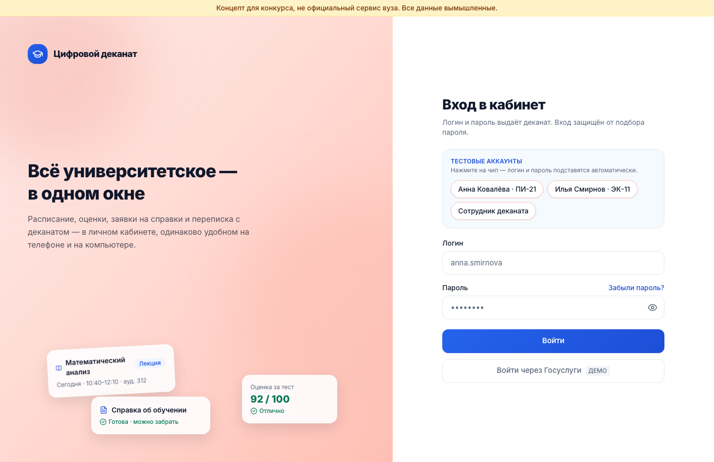
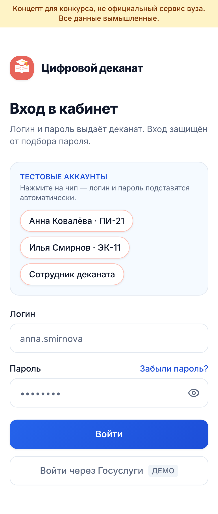

# Digital Deanery — Student Portal

**[🇷🇺 Русский](README.md) | [🇬🇧 English](README.en.md)**

> **A competition concept** for the "Digital Deanery of the Future" hackathon.
> A working prototype, not an official university service. All data is
> fictional; the university logo is not used.

A single student portal where everything study-related lives in one place:
schedule, academic performance, requests and certificates, notifications,
deanery messaging, AI assistant, student startup catalog, and much more —
equally convenient on a phone and on a desktop. The code is written by AI
agents (OpenCode swarms); humans set tasks and approve merges.

## Screenshots

| Desktop 1440 | Mobile 360 |
|---|---|
| [](docs/design/screenshots/design-full-desktop-1440.png) | [](docs/design/screenshots/design-full-mobile-360.png) |

## Live demo

https://ostrovok.store — Timeweb Cloud VM + Docker Compose + Caddy (auto-TLS).

## Deanery MCP server

> For agents: connect to `https://ostrovok.store/api/mcp` (Streamable HTTP, MCP `2025-06-18`)
> to read the token owner's schedule, grades and notifications — their data only, read-only.

The portal ships a **real MCP server** (Model Context Protocol): any compatible assistant
(Claude, Cursor, Codex, VS Code) connects with a personal Bearer token and calls the
`my_schedule_today`, `my_grades`, `my_unread` tools. The token is issued by the student in
**Settings → “MCP setup”**, stored as SHA-256 only, every call is owner-scoped (IDOR impossible),
and request frequency is rate-limited.

Full reference: **[`docs/mcp-en.md`](docs/mcp-en.md)** (EN) · **[`docs/mcp.md`](docs/mcp.md)** (RU) —
endpoint, client JSON configs, a curl session, example prompts, FAQ.
Interactive version: the `/mcp` page in the portal; a Help article at `/help` (RU/EN).

## Documentation — quick links

| Section | Audience |
|---|---|
| [`docs/mcp-en.md`](docs/mcp-en.md) · [`docs/mcp.md`](docs/mcp.md) | **Deanery MCP server**: assistant connection (Claude/Cursor/Codex), tools, curl examples, security (EN/RU) |
| [`docs/help.md`](docs/help.md) | Student: sign-in, schedule, grades, requests, notifications, verifiable certificates |
| [`docs/assistant.md`](docs/assistant.md) | Digital assistant: capabilities, example queries, limitations, MCP integrations |
| [`docs/architecture.md`](docs/architecture.md) | Developer: Next.js 15, Prisma, data layers, DB schema |
| [`docs/security.md`](docs/security.md) | Security in plain words: IDOR, passwords, keys |
| [`docs/deploy.md`](docs/deploy.md) | Deployment: Docker Compose, Caddy, production |
| [`docs/figma-screens.md`](docs/figma-screens.md) | Screen ↔ task ↔ Figma frame map |
| [`docs/user-guide-en.md`](docs/user-guide-en.md) · [`docs/user-guide-ru.md`](docs/user-guide-ru.md) | **User guide**: every student and staff screen step-by-step (EN/RU) |
| [`docs/admin-guide-en.md`](docs/admin-guide-en.md) · [`docs/admin-guide-ru.md`](docs/admin-guide-ru.md) | **Administrator guide**: secrets, deploy, seed, backups, incidents (EN/RU) |
| [`docs/accompanying-docs-en.md`](docs/accompanying-docs-en.md) · [`docs/accompanying-docs-ru.md`](docs/accompanying-docs-ru.md) | **Accompanying documentation**: the docs map, glossary, non-goals (EN/RU) |
| [`docs/sdd/SDD-GUIDE.md`](docs/sdd/SDD-GUIDE.md) | Spec-driven process (OpenSpec) |
| [`docs/wiki/`](docs/wiki/) | Wiki: architecture, swarm, modules guide, runbook (staleness list: [`docs/REPORT-112.md`](docs/REPORT-112.md)) |
| [`CHANGELOG.md`](CHANGELOG.md) · [`docs/ai-log/`](docs/ai-log/) | What the swarm did and when |

## Feature set

- **Mandatory core**: sign-in with demo accounts, dashboard («Your week»),
  schedule with lesson details panel, grades summary/gradebook/discipline/session,
  requests with a 3-step wizard and canonical status machine (ЗД-/SR- numbers,
  PDF certificates with QR verification at `/verify/<code>`), notifications hub
  with bell panel, tasks & deadlines.
- **Experience features**: deanery messaging (TS-numbered tickets with chat),
  feedback channel to the management (incl. anonymous), teacher directory with
  «My teachers» and «Upcoming classes», news & announcements, campus events
  with sign-up, student startup catalog «МСП» (Product Hunt style: upvotes,
  comments, launch of the day), additional education catalog with progress and
  documents, student finance (contracts, stipend, payments), FAQ knowledge
  base, detailed «How to use the portal» guide with search.
- **AI features**: assistant screen with action cards, floating corner
  assistant powered by OpenRouter with RAG over the in-app guide (graceful
  offline fallback), AI guide walking students through screens, AI explanation
  of grade dynamics with an interactive chart, voice input & schedule
  read-aloud, MCP server exposing grades/schedule/requests to external LLM
  assistants.
- **Staff cabinet** (`/staff`): faculty-scoped request queue with SLA
  highlighting, request card with the allowed status transitions and mandatory
  reason on rework, certificate PDF, deanery ticket chat with reply templates,
  faculty announcements, daily summary.
- **Internationalization**: full RU/EN interface with a header switch
  (cookie-persisted, no-JS fallback); demo content stays Russian by design.
- **Micro-animations**: staggered card entrances, hover-lift, press feedback,
  skeleton shimmer, bell swing — all disabled under `prefers-reduced-motion`.

## Mandatory core

| Area | Linear tasks | Figma screens |
|---|---|---|
| Sign-in and profile | DIG-18, DIG-19, DIG-11 | 01, 22 |
| Schedule (day/week/month, reschedules) | DIG-21–24 | 03–04 |
| Grades (summary, gradebook, session) | DIG-25–28 | 05–07 |
| Requests and certificates (online ordering, statuses) | DIG-29–33, DIG-47 | 08–11, 26 |
| Notifications and announcements | DIG-34–36 | 12–14 |

Beyond the core: tasks and deadlines, finance, directory, news, MSP
(student startups), continuing education, campus events, deanery messages
and the feedback channel, FAQ and the step-by-step guide — an article per
menu screen (DIG-112), ⌘K search, the **cabinet AI assistant**, the deanery
staff cabinet. Accessibility — the low-vision plain version (DIG-100);
sharing — news and schedule-day «Share», schedule export to MD/XLSX/PDF
(DIG-101).

## Tech stack

- **Framework**: Next.js 15 (App Router, React Server Components by default), React 19
- **Language**: TypeScript (strict), ESLint + Prettier
- **Data**: Prisma ORM + PostgreSQL (auth/users/sessions); domain prototype data — in-memory adapter with a deterministic demo seed
- **Auth**: custom sessions — argon2 password hashing, `__Host-session` cookie, HMAC-signed role hint cookie, per-IP rate limiting, account lockout
- **Styling**: Tailwind CSS + design tokens (coral/accent palettes), Inter font
- **Tests**: Vitest (unit, 1900+) + Playwright (e2e, desktop 1440 & mobile 360)
- **Infra**: Docker Compose (app + db + caddy), Caddy TLS, manual rsync deploys
- **Work management**: Linear project + OpenCode agent swarm (GLM-5.3-flash)

## Quick start (3 commands)

```bash
pnpm install
cp .env.example .env        # fill DATABASE_URL (local Postgres)
pnpm dev                    # http://localhost:3000
```

Demo data is seeded automatically on first start (fictional students,
schedule, grades, requests). Jury accounts are created by the seed.

### Run in Docker (one command)

```bash
docker compose -f deploy/docker-compose.yml --profile tools up --build
```

## Test accounts (fictional)

| Login | Password | Who |
|---|---|---|
| `anna.smirnova` | `anna-demo-2026` | Anna Smirnova, 2nd-year CS student |
| `ilya.petrov` | `ilya-demo-2026` | Ilya Petrov, student with debts and retakes |
| `dean.kovaleva` | `dean-demo-2026` | Deanery staff member (staff cabinet `/staff`) |

## AI agent swarm

The code is written by an automated swarm built on OpenCode CLI and
GLM-5.3-flash. The supervisor restarts the orchestrator after crashes; the
orchestrator takes tasks labeled `swarm` from Linear, creates a branch, and
runs the task through executor → gates (lint/typecheck/build/test) → reviewer
(fresh context, ACCEPT/RETURN verdicts) → security (IDOR/secrets PASS/FAIL) →
documenter (changelog + ai-log) → pull request. See
[`docs/wiki/SWARM.md`](docs/wiki/SWARM.md) for the full contract, prompts,
rate-limit policy, and the salvage procedure for orphaned branches.

```bash
node scripts/swarm/orchestrator.mjs --max 1        # one task
node scripts/swarm/orchestrator.mjs --dry-run      # show the queue only
```

## Deployment

Manual rsync deploys from a clean worktree; the server checklist, secrets
(`AUTH_SECRET`, `DATABASE_URL`, `OPENROUTER_API_KEY`), demo seeding and the
production regression suite are described in
[`docs/wiki/RUNBOOK.md`](docs/wiki/RUNBOOK.md) and [`docs/deploy.md`](docs/deploy.md).

## Security

Everything is fictional: no real personal data, no university branding, a
«Concept entry for the hackathon» banner on every page, IDOR impossible by
construction (owner-scoped queries + unified 404 + audit log of denials),
secrets only in `.env` (never committed). Details:
[`docs/security.md`](docs/security.md).

## Documents (for agents)

`openspec/` (spec-driven changes), `docs/ai-log/` (swarm journal),
`docs/BRANCHES-ARCHIVE.md` (SHA heads of deleted branches), `docs/wiki/`
(architecture, swarm, modules guide, runbook, screens map).
