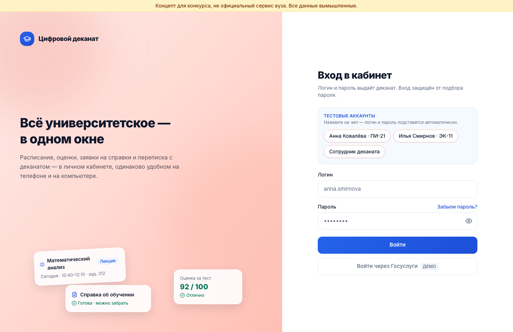
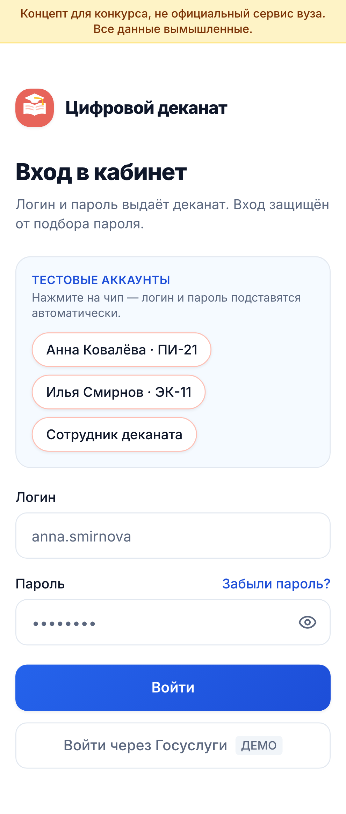

# Цифровой деканат — личный кабинет студента

**[🇷🇺 Русский](README.md) | [🇬🇧 English](README.en.md)**

> **Концепт для конкурса** «Цифровой деканат будущего». Прототип, не
> официальный сервис. Все данные вымышленные, логотип вуза не используется.

Личный кабинет студента, где всё, что связано с учёбой, — в одном месте:
расписание, успеваемость, заявки и справки, уведомления, обращения в деканат.
С современного телефона и с компьютера. Код пишут ИИ-агенты (рои OpenCode),
человек ставит задачи и принимает merge.

## Скриншоты

| Десктоп 1440 | Мобильный 360 |
|---|---|
| [](docs/design/screenshots/design-full-desktop-1440.png) | [](docs/design/screenshots/design-full-mobile-360.png) |

## MCP-сервер деканата

> Для агентов: подключайтесь к `https://ostrovok.store/api/mcp` (Streamable HTTP, MCP `2025-06-18`),
> чтобы читать расписание, оценки и уведомления владельца токена — только его данные, только чтение.

Кабинет предоставляет **настоящий MCP-сервер** (Model Context Protocol): любой совместимый ассистент
(Claude, Cursor, Codex, VS Code) подключается по персональному Bearer-токену и вызывает инструменты
`my_schedule_today`, `my_grades`, `my_unread`. Токен выпускается студентом в **Настройках → «Настройка MCP»**,
хранится только как SHA-256, каждый вызов скоуплен владельцем (IDOR исключён), частота ограничена.

Полный референс: **[`docs/mcp.md`](docs/mcp.md)** (RU) · **[`docs/mcp-en.md`](docs/mcp-en.md)** (EN) —
endpoint, JSON-конфиги для клиентов, curl-сессия, примеры промптов, FAQ.
Интерактивная версия — страница `/mcp` в кабинете; статья в справке `/help` (RU/EN).

## Документация — быстрые ссылки

| Раздел | Для кого |
|---|---|
| [`docs/mcp.md`](docs/mcp.md) · [`docs/mcp-en.md`](docs/mcp-en.md) | **MCP-сервер деканата**: подключение ассистента (Claude/Cursor/Codex), инструменты, curl-примеры, безопасность (RU/EN) |
| [`docs/help.md`](docs/help.md) | Студент: вход, расписание, оценки, заявки, уведомления, справки с проверкой подлинности |
| [`docs/assistant.md`](docs/assistant.md) | Цифровой ассистент: возможности, примеры запросов, ограничения, MCP-интеграции (Product Hunt и др.) |
| [`docs/architecture.md`](docs/architecture.md) | Разработчику: Next.js 15, Prisma, слои данных, схема БД |
| [`docs/security.md`](docs/security.md) | Безопасность простыми словами: IDOR, пароли, ключи |
| [`docs/deploy.md`](docs/deploy.md) | Деплой: Docker Compose, Caddy, прод |
| [`docs/figma-screens.md`](docs/figma-screens.md) | Карта «экран ↔ задача ↔ фрейм Figma» |
| [`docs/user-guide-ru.md`](docs/user-guide-ru.md) · [`docs/user-guide-en.md`](docs/user-guide-en.md) | **Руководство пользователя**: все экраны студента и сотрудника пошагово (RU/EN) |
| [`docs/admin-guide-ru.md`](docs/admin-guide-ru.md) · [`docs/admin-guide-en.md`](docs/admin-guide-en.md) | **Руководство администратора**: секреты, деплой, сид, бэкап, инциденты (RU/EN) |
| [`docs/accompanying-docs-ru.md`](docs/accompanying-docs-ru.md) · [`docs/accompanying-docs-en.md`](docs/accompanying-docs-en.md) | **Сопроводительная документация**: карта документов, глоссарий, non-goals (RU/EN) |
| [`docs/sdd/SDD-GUIDE.md`](docs/sdd/SDD-GUIDE.md) | Spec-driven процесс (OpenSpec) |
| [`CHANGELOG.md`](CHANGELOG.md) · [`docs/ai-log/`](docs/ai-log/) | Что и когда делал рой |

## Обязательное ядро

| Раздел | Задача Linear | Экран Figma |
|---|---|---|
| Вход и профиль | DIG-18, DIG-19, DIG-11 | 01, 22 |
| Расписание (день/неделя/месяц, переносы) | DIG-21, DIG-22, DIG-23, DIG-24 | 03–04 |
| Успеваемость (зачётка, сессия, «как у меня дела») | DIG-25, DIG-26, DIG-27, DIG-28 | 05–07 |
| Заявки и справки (заказ онлайн, статусы) | DIG-29, DIG-30, DIG-31, DIG-32, DIG-33, DIG-47 | 08–11, 26 |
| Уведомления и объявления | DIG-34, DIG-35, DIG-36 | 12–14 |

Дополнительно: справочник, FAQ, обращения, предложения руководству, финансы,
доп. образование, мероприятия, поиск ⌘K, **AI-ассистент кабинета**, кабинет
сотрудника деканата. Полная карта — `docs/figma-screens.md`.

## Стек

Next.js 15 (App Router, TypeScript) · Prisma + PostgreSQL · Tailwind CSS
(дизайн-токены, Inter) · собственные cookie-сессии (argon2id-хэши) ·
Vitest + Playwright · Docker Compose + Caddy (авто-TLS) · Linear + GitHub +
OpenCode.

## Быстрый старт (3 команды)

```bash
pnpm install
cp .env.example .env
pnpm dev
```

Приложение: http://localhost:3000. Требования: Node 22 LTS, pnpm 10 (`corepack enable`).

### Запуск в Docker (одна команда)

```bash
cp .env.example .env
docker compose -f deploy/docker-compose.yml up --build
```

Тот же стек, что и на проде: app (Next.js standalone) + PostgreSQL 16 +
Caddy (авто-TLS в проде). Кабинет — http://localhost:3000, health —
`/api/health`; миграции Prisma применяются при старте контейнера. Подробности —
[`docs/deploy.md`](docs/deploy.md).

Проверки: `pnpm lint` · `pnpm typecheck` · `pnpm test` (Vitest unit + swarm) ·
`pnpm e2e` (Playwright: desktop-1440 и mobile-360×800). БД (Prisma/PostgreSQL) и
вход подключаются в следующих задачах — скаффолд работает без них.

## Тестовые аккаунты (вымышленные)

Чипы на экране входа и этот раздел — один канон: фамилия в чипе = фамилия в
логине = ФИО в профиле (DIG-81, BUG-07). Те же логины создаёт `pnpm db:seed`
для prisma-хранилища (DIG-50); все данные вымышленные. В коде и БД — только
argon2id-хэши; открытые пароли — только здесь, для жюри.

| Логин | Пароль | Кто |
|---|---|---|
| `anna.smirnova` | `anna-demo-2026` | Анна Смирнова, 2 курс ПИ-21: хорошая успеваемость, 1 долг (пересдача), заявки и обращения в работе |
| `ilya.petrov` | `ilya-demo-2026` | Илья Петров, 1 курс ЭК-11: без долгов, перезачёт и практика в работе |
| `dean.kovaleva` | `dean-demo-2026` | Мария Ковалёва, специалист деканата |

БД и сиды: `pnpm db:migrate` (нужен Postgres из `.env`), затем `pnpm db:seed`.
Сид идемпотентен: повторный запуск не дублирует данные, расписание каждый раз
пересчитывается относительно текущей недели (демо остаётся «живым»).

## Рой ИИ-агентов

Задачи Linear (команда DIG, метка `swarm`) рой проходит сам:

```
pick → claim → executor (GLM) → гейты → reviewer → security → documenter → PR
```

- Архитектура и уроки: [`scripts/swarm/README.md`](scripts/swarm/README.md)
- Диаграмма процесса (для PDF): [`docs/ai-process.md`](docs/ai-process.md)
- Журнал циклов: [`docs/ai-log/`](docs/ai-log/)
- Запуск: `node scripts/swarm/orchestrator.mjs --max 1` (подробности в `AGENTS.md`)

## Деплой

https://ostrovok.store — Timeweb Cloud VM + Docker Compose + Caddy (авто-TLS).
Детали: [`docs/deploy.md`](docs/deploy.md). Команда: `bash scripts/swarm/deploy.sh`.

## Безопасность

- Только свои данные: фильтрация по сессии на сервере, тесты на IDOR.
- Пароли — только argon2id-хэши, вход ограничен rate-limit'ом.
- Секреты — в окружении, `.env` не в git; в браузер не попадают.
- Простыми словами: [`docs/security.md`](docs/security.md).

## Документы (для агентов)

`docs/sdd/SDD-GUIDE.md` (OpenSpec) · правила для агентов — `AGENTS.md`.
Вопросы по продукту — раздел «Документация — быстрые ссылки» выше.
