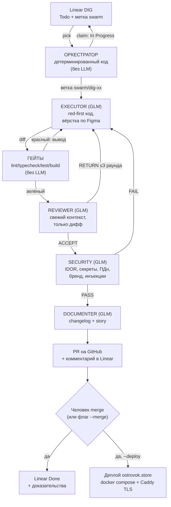

# Как ИИ-рои строит «Цифровой деканат» (для PDF-описания конкурса)

> Коротко: человек формулирует задачи в Linear, а рой ИИ-агентов OpenCode
> доводит каждую до PR: код → тесты → ревью → security → документация.
> Человек только принимает merge и подаёт работу.

## Схема роя

## Роли и модели

| Роль | Модель | Задача |
|---|---|---|
| Оркестратор | без LLM (Node) | конечный автомат: ветки, вызовы, маркеры, Linear |
| Линейный клерк | без LLM (GraphQL) | pick/claim/comment/Done |
| Executor | GLM-5.3 | код и вёрстка задачи, red-first |
| Tester (гейты) | без LLM | lint → typecheck → vitest → build |
| Reviewer | GLM-5.3, свежий контекст | судит только дифф: ACCEPT/RETURN |
| Security | GLM-5.3, свежий контекст | IDOR, секреты, ПДн, бренд, инъекции |
| Documenter | GLM-5.3 | changelog, non-goal, история |
| Деплой | без LLM (bash) | rsync → docker compose → health-check |

Независимость ревью — через **свежий контекст**: reviewer и security получают
задачу и дифф, но никогда не видят рассуждения исполнителя.

## Документы для самих агентов

- `AGENTS.md` — правила проекта: стек, запреты (реальные ПДн, секреты, бренд), DoD.
- `.opencode/agent/executor.md | reviewer.md | security.md | documenter.md` —
  системные промпты ролей с маркерными контрактами.
- `.agents/skills/swarm/SKILL.md` + `.opencode/command/swarm.md` — как запускать.
- `docs/figma-screens.md` — соответствие «экран ↔ задача ↔ фрейм Figma».
- `openspec/` — спеки и change-предложения (SDD, см. `docs/sdd/SDD-GUIDE.md`).
- `docs/ai-log/` — журнал циклов роя: что сделал, что вернул ревью, как исправили.

## Как рой справляется с ошибками ИИ

1. **Гейты не верят словам**: единственный вердикт тестера — код выхода; вывод
   красного гейта целиком возвращается исполнителю на исправление (до 3 раундов).
2. **Ревьюер без «стокгольмского синдрома»**: он не видел ни одного слова
   исполнителя — только дифф; отсутствие строки `VERDICT` трактуется как RETURN,
   отдельный meta-проход спасает анализ без вердикта.
3. **Security не торгуется**: FAIL по IDOR/секретам возвращает задачу исполнителю.
4. **Потерянная работа не теряется**: ветка пересоздаётся без `-B`, потерянные
   коммиты ищутся в reflog и чэрри-пикаются; «уже в main» закрывается как Done.
5. **Висящий воркер не вешает цикл**: таймауты с detached-группой процессов.
6. **Люди видят всё**: каждый сбой — комментарий в Linear; ничего не закрывается
   без PR и зелёных гейтов.

## Журнал живого процесса

Каждый цикл роя пишет `docs/ai-log/<дата>-<задача>.md`: агенты, раунды, гейты,
вердикты, история. Запуски: `.task-board/log/cycle-*.log`.
