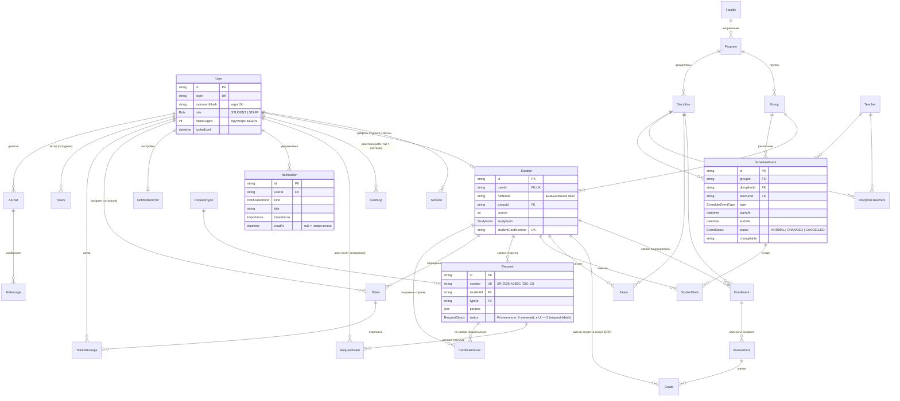

# Архитектура

> **Концепт для конкурса** «Цифровой деканат будущего» — прототип, данные
> вымышленные. Смежные документы: [справка студента](help.md) ·
> [цифровой ассистент](assistant.md) · [безопасность простыми
> словами](security.md).

## Слои

```
Браузер (моб. 360px / десктоп 1440px)
   │  httpOnly cookie-сессия (__Host-session)
   ▼
Next.js 15 (App Router, RSC)
   ├─ src/app/(auth)/login         — вход (rate limit)
   ├─ src/app/(cabinet)/…          — экраны кабинета (layout = Shell)
   ├─ src/server/actions/          — мутации, каждая проверяет владельца
   ├─ src/server/auth/             — сессии, роли STUDENT|STAFF (Prisma-стора на проде)
   ├─ src/server/data/             — порт данных; учебные данные — in-memory демо-стора (DIG-12)
   └─ src/app/globals.css          — дизайн-токены (CSS-переменные)
   ▼
Prisma + PostgreSQL (docker) — целевой путь хранилищ (схема и миграции готовы)
```

## Ключевые решения

1. **RSC-first**: данные читаются на сервере — чужие данные физически не
   покидают сервер (основа защиты от IDOR).
2. **Server actions с проверкой сессии** — одна точка контроля доступа,
   повторяемая в каждом действии и покрытая тестами.
3. **Дизайн-токены** в `src/app/globals.css` (CSS-переменные) — источник
   цветов/радиусов; компоненты не хардкодят значения (соответствие Figma,
   контракт закреплён тестом `tests/design-tokens.test.ts`).
4. **Shell-компонент** — шапка+меню как в макете «Shell · Кабинет»: одно
   место правды навигации; mobile-навигация (bottom tabs) в том же компоненте.
5. **Сиды вымышленных данных** — `prisma/seed.ts` (PostgreSQL) и
   `src/server/data/demo-seed.ts` (in-memory стора): детерминированные
   ФИО/группы; два студента и один сотрудник для жюри.
6. **AI-ассистент** (DIG-46) — карточки действий поверх данных кабинета;
   LLM-ключ только серверный, без прокидывания в браузер.

## Безопасность (кратко)

Полный разбор простыми словами — [`docs/security.md`](security.md). Суть:

1. **IDOR невозможен по построению**: данные читаются только через
   `src/server/data/*`, каждая функция принимает контекст сессии
   (`DataCtx`) с владельцем; прямой импорт Prisma вне `src/server/`
   запрещён ESLint-правилом и закреплён тестами. Чужой и несуществующий
   объекты отвечают одинаково (404), различие уходит в журнал аудита.
2. **Пароли** — только argon2id-хэши (`@node-rs/argon2`, параметры OWASP);
   сессия — случайный 256-битный токен в httpOnly-cookie `__Host-session`,
   в БД лишь его SHA-256; скользящее продление: когда остаётся меньше
   половины TTL, сессия продлевается снова до полных 7 дней.
3. **Вход** ограничен: 5 неудачных попыток → блокировка на 15 минут +
   rate limit по IP (доверенный адрес — из `X-Real-IP` обратного прокси).
4. **Ключи** — только в окружении; `.env` не в git, в браузер секреты
   не попадают (без `NEXT_PUBLIC_`); LLM-ключ ассистента — только серверный.
5. Мутационные API проверяют Origin (fail-closed, 403); заголовки
   безопасности (CSP, X-Frame-Options) не ослабляются.

## Инфраструктура

- `deploy/docker-compose.yml`: app (Next standalone), postgres, caddy.
- Caddy: авто-TLS (HTTP-01) для ostrovok.store и www.
- Деплой: `scripts/swarm/deploy.sh` (rsync + compose up + health-check).

## Схема данных (DIG-9)

Источник правды — `prisma/schema.prisma` (Prisma 7: URL подключения в
`prisma.config.ts`, из окружения `DATABASE_URL`). Одна базовая миграция
`prisma/migrations/20261111135255_init/` (регенерирована в DIG-49 после
reconcile канона DIG-9 с сидами DIG-10 и auth DIG-11), дальше только
дополнения.

### ER-диаграмма



### Ручные фрагменты SQL в миграции

`20261111135255_init` содержит и то, что Prisma-схема не выражает:

1. **sequence `request_number_seq` + CHECK `^ЗД-[0-9]{4}-[0-9]{6}$`** —
   фрагмент канона DIG-9 (сквозная нумерация заявок). Приложение его не
   использует: видимый номер заявки с DIG-12 строит
   `src/server/data/request-number.ts` — неперебираемый
   `SR-<год>-<5 случайных A-Z0-9>`, уникальность — UNIQUE-индекс. Учебные
   данные сейчас живут в in-memory демо-сторе, поэтому заявки через эту
   таблицу не проходят; при переводе стора на PostgreSQL фрагмент нужно
   согласовать с SR-форматом.
2. **CHECK-констрейнты**: `Grade.value` в диапазоне 0..10 (формат номера
   заявки `^ЗД-…$` из пункта 1 — legacy канона DIG-9, приложением не
   используется).
3. **FTS для FAQ**: генерируемая колонка `FaqArticle.search`
   (`to_tsvector('russian', …)` по title, body, question, answer) +
   GIN-индекс — подготовлено к Prisma-сторе. Сейчас поиск по FAQ работает
   в памяти (`src/lib/faq-catalog.ts` + матчинг в
   `src/server/data/search.ts`); SQL-FTS включится вместе с Postgres-стора.

Из-за колонки `search` Prisma считает состояние БД «drift» относительно
схемы. Поэтому новые миграции создавать только через
`prisma migrate diff --from-config-datasource --to-schema prisma/schema.prisma`
и **удалять** из результата строки `DROP INDEX "FaqArticle_search_idx"` /
`DROP COLUMN "search"` (CHECK-констрейнты Prisma не трогает). Проверить,
что миграции применяются: `prisma migrate deploy` на чистой БД.

### Индексы

- Все внешние ключи имеют индекс (проверяется тестом
  `tests/prisma-schema.test.mjs` по миграции).
- Расписание: `ScheduleEvent (groupId, startsAt)`, `(teacherId, startsAt)`.
- Уведомления: `Notification (userId, readAt)` — счётчик непрочитанных,
  `(userId, createdAt)` — лента.
- Скоупы студента: индексы по `studentId` во всех учебных/заявочных таблицах —
  запросы всегда фильтруются по владельцу (анти-IDOR).
