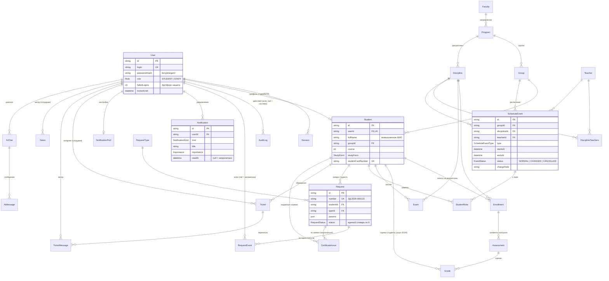

# Архитектура

## Слои

```
Браузер (моб. 360px / десктоп 1440px)
   │  httpOnly cookie-сессия
   ▼
Next.js 15 (App Router, RSC)
   ├─ src/app/(auth)/login         — вход (rate limit)
   ├─ src/app/(app)/…              — экраны кабинета (layout = Shell)
   ├─ src/server/actions/          — мутации, каждая проверяет владельца
   ├─ src/lib/auth.ts              — сессии, роли student|staff
   └─ src/lib/db.ts                — Prisma client (singleton)
   ▼
Prisma → PostgreSQL (docker)
```

## Ключевые решения

1. **RSC-first**: данные читаются на сервере — чужие данные физически не
   покидают сервер (основа защиты от IDOR).
2. **Server actions с проверкой сессии** — одна точка контроля доступа,
   повторяемая в каждом действии и покрытая тестами.
3. **Дизайн-токены** в `src/styles/tokens.css` — источник цветов/радиусов;
   компоненты не хардкодят значения (соответствие Figma).
4. **Shell-компонент** — шапка+меню как в макете «Shell · Кабинет»: одно
   место правды навигации; mobile-навигация (bottom tabs) в том же компоненте.
5. **Сиды вымышленных данных** (`prisma/seed.ts`) — детерминированные ФИО/группы;
   два студента и один сотрудник для жюри.
6. **AI-ассистент** (DIG-46) — карточки действий поверх данных кабинета;
   LLM-ключ только серверный, без прокидывания в браузер.

## Инфраструктура

- `deploy/docker-compose.yml`: app (Next standalone), postgres, caddy.
- Caddy: авто-TLS (HTTP-01) для ostrovok.store и www.
- Деплой: `scripts/swarm/deploy.sh` (rsync + compose up + health-check).

## Схема данных (DIG-9)

Источник правды — `prisma/schema.prisma` (Prisma 7: URL подключения в
`prisma.config.ts`, из окружения `DATABASE_URL`). Одна базовая миграция
`prisma/migrations/20261111000000_init/`, дальше только дополнения.

### ER-диаграмма



### Ручные фрагменты SQL в миграции

`20261111000000_init` содержит и то, что Prisma-схема не выражает:

1. **sequence `request_number_seq`** — нумерация заявок; приложение собирает
   `ЗД-<год>-<6 цифр>` (формат гарантирует CHECK, уникальность — UNIQUE).
2. **CHECK-констрейнты**: формат номера заявки `^ЗД-[0-9]{4}-[0-9]{6}$` и
   `Grade.value` в диапазоне 0..10.
3. **FTS для FAQ**: генерируемая колонка `FaqArticle.search`
   (`to_tsvector('russian', …)`, title вес A, body вес B) + GIN-индекс;
   поиск — через `$queryRaw` и `to_tsquery('russian', :query)`.

Из-за колонки `search` Prisma считает состояние БД «drift» относительно
схемы. Поэтому новые миграции создавать только через
`prisma migrate diff --from-config-datasource --to-schema prisma/schema.prisma`
и **удалять** из результата строки `DROP INDEX "FaqArticle_search_idx"` /
`DROP COLUMN "search"` (CHECK-констрейнты Prisma не трогает). Проверить,
что миграции применяются: `prisma migrate deploy` на чистой БД.

### Индексы

- Все внешние ключи имеют индекс (проверяется тестом
  `tests/prisma-schema.test.mjs` по миграции).
- Расписание: `ScheduleEvent (groupId, startsAt)`, `(teacherId, startsAt)`.
- Уведомления: `Notification (userId, readAt)` — счётчик непрочитанных,
  `(userId, createdAt)` — лента.
- Скоупы студента: индексы по `studentId` во всех учебных/заявочных таблицах —
  запросы всегда фильтруются по владельцу (анти-IDOR).
