# User Guide (EN)

> «Digital Deanery» — a student portal. **A hackathon concept prototype**: all data is fictional. Live: https://ostrovok.store
>
> **Languages:** the interface is available in Russian and English — the **RU | EN** switch is in the right part of the header. Your choice persists across visits.
>
> Every chapter follows the same structure: what the screen is **for**, a **step-by-step walkthrough**, a **screenshot** (mobile 360 px / desktop 1440 px) and a description of the on-screen elements.

## Table of contents

1. [Sign-in & security](#1-sign-in--security)
2. [Home (/dashboard)](#2-home-dashboard)
3. [Services catalog (/services)](#3-services-catalog-services)
4. [Schedule (/schedule)](#4-schedule-schedule)
5. [Performance (/grades)](#5-performance-grades)
6. [Requests & certificates (/requests)](#6-requests--certificates-requests)
7. [Deanery tickets (/deanery)](#7-deanery-tickets-deanery)
8. [Feedback to the management (/feedback)](#8-feedback-to-the-management-feedback)
9. [Tasks (/tasks)](#9-tasks-tasks)
10. [News (/news)](#10-news-news)
11. [Directory (/people)](#11-directory-people)
12. [Events (/events)](#12-events-events)
13. [MSP — student startups (/msp)](#13-msp--student-startups-msp)
14. [Additional education (/dpo)](#14-additional-education-dpo)
15. [Finance (/finance)](#15-finance-finance)
16. [FAQ (/help) and the Guide (/guide)](#16-faq-help-and-the-guide-guide)
17. [AI assistant (/ai-assistant)](#17-ai-assistant-ai-assistant)
18. [Notifications (/notifications)](#18-notifications-notifications)
19. [Search (⌘K / Ctrl+K)](#19-search--k--ctrlk)
20. [Profile (/profile)](#20-profile-profile)
21. [Settings (/settings)](#21-settings-settings)
22. [For the deanery staff (/staff)](#22-for-the-deanery-staff-staff)
23. [Mobile version](#23-mobile-version)
24. [Prototype limitations](#24-prototype-limitations)

## 1. Sign-in & security

**Purpose.** The landing page explains what the portal can do; the sign-in form opens access to personal data — student or staff, depending on the role.

### 1.1. How to sign in (step by step)

1. Open https://ostrovok.store — you land on the overview page describing the capabilities.
2. Press **«Войти в кабинет» / «Sign in»** — the login form opens.
3. Enter the login and password (for the jury — the demo accounts from the table below), or use the quick-login buttons under the form.
4. Press **Sign in**. After a successful sign-in a student lands on **/dashboard** and a staff member lands on **/staff**.

| Role | Login | Password | Who |
|---|---|---|---|
| Student | `anna.smirnova` | `anna-demo-2026` | Anna Smirnova, 2nd-year CS: good grades, requests in progress |
| Student | `ilya.petrov` | `ilya-demo-2026` | Ilya Petrov: debts and retakes — for the «bad path» scenarios |
| Staff | `dean.kovaleva` | `dean-demo-2026` | Maria Kovaleva, the IT-faculty deanery (the `/staff` cabinet) |

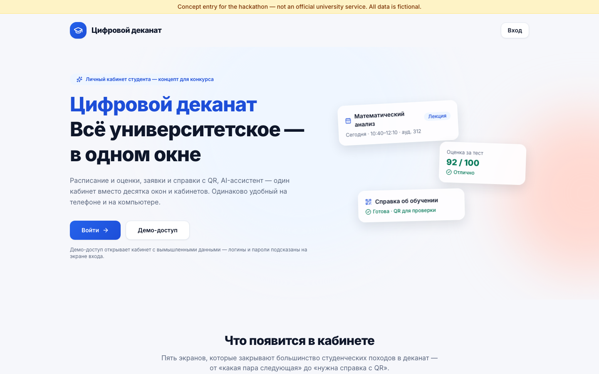
*The landing page with the capability overview and the sign-in button*

### 1.2. Sign-in protection

- **Rate limit:** at most 30 attempts per 15 minutes per IP; beyond that — «Too many attempts, wait N minutes».
- **Account lockout:** 5 wrong passwords in a row temporarily lock the account.
- **Sessions:** a sign-in creates a 30-day session; **Settings → Security** lists active sessions (device, IP, date) — revoke any of them.
- **Sign out:** the «Sign out» button in the profile menu deletes the session and both cookies (`__Host-session`, `__Host-role`) and lands you on a signed-out notice.
- **Password recovery:** the «Forgot password?» link is a prototype stub (real e-mail delivery is out of the concept's scope).

### 1.3. Data isolation

The portal shows **only your data**: other people's requests, tickets and grades are technically unreachable — any query for a foreign object returns the same unified 404, and the attempt is written to the audit log. The «Found an error in a grade? Write to the deanery» link on the performance page is the legitimate way to report a mismatch.

## 2. Home (/dashboard)

**Purpose.** The summary start screen: what is happening today, how your grades and requests stand, and where to go first.

**How to use it (step by step):**

1. Sign in — you land on /dashboard automatically.
2. Read the **«Your week» hero**: the day summary (moved / cancelled / retake soon) and the GPA, credits, debts and requests tiles.
3. Check the **«Today»** and **«Deadlines»** widgets — what needs attention right now.
4. Use the **quick actions**: «Order a certificate» and «Write to the deanery» — they open the request wizard and the ticket form.
5. If the block order does not suit you — **Settings → Widgets** (drag, enable/disable).
6. Fresh events live in the bell panel; «All notifications» opens the full hub.

- **The «Your week» hero**: a greeting with the date, the day summary (moved / cancelled / retake in N days), and tile links: GPA (the credit-weighted average), Credits (of 240), Debts (retake required / all done), Requests in progress.
- **Quick actions**: «Order a certificate», «Write to the deanery».
- **Widgets** (order and visibility configured in Settings → Widgets): Today (lessons with moved/cancelled marks), Deadlines, Tasks, Performance, Requests, News, Events.
- **Recent notifications**: the bell panel mirrors the latest events; «All notifications» opens the full hub.
- **Configure notifications** — a direct link to the notification settings.

Tiles and blocks are clickable — each leads to its section.

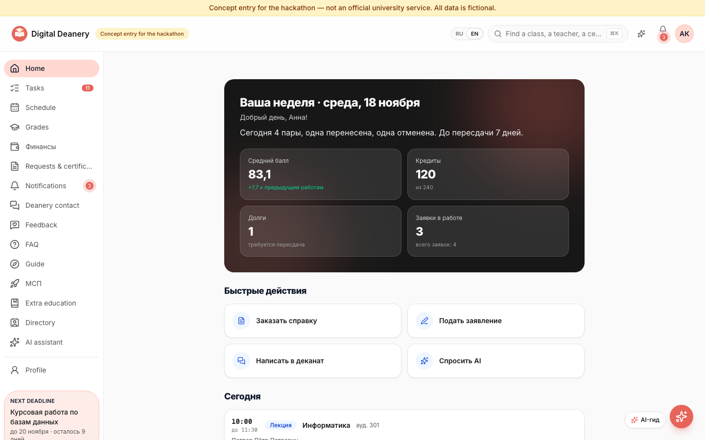
*Home: the «Your week» hero, the GPA/credits/debts/requests tiles, the widgets*

## 3. Services catalog (/services)

**Purpose.** A catalog of deanery and university services, filtered for your role and year: find the right service quickly and jump straight to ordering it.

**How to use it (step by step):**

1. Open **«Services»** in the cabinet menu.
2. Filter the catalog with the **category pills** (six categories) — the list narrows instantly.
3. Pin a frequently needed service to **«Favorites & frequently used»** (up to 6 pins; stored on the server and carried across devices).
4. The **«Often needed in year N»** block suggests services without duplicating the favorites — use it when you do not know what to look for.
5. Clicking a service card opens the request wizard (see section 6) with the document type pre-filled.

For a staff member the catalog shows an empty state — services are personal and student-only.

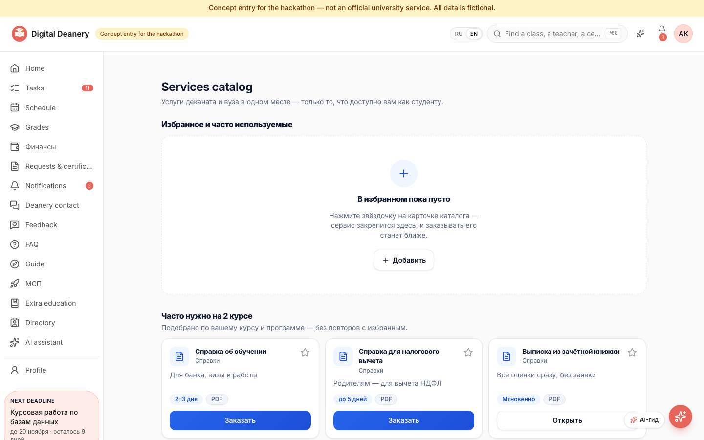
*The services catalog: categories, favorites, «often needed this year»*

## 4. Schedule (/schedule)

**Purpose.** Lessons for the day, week and month; lesson details with homework, materials and rescheduling/cancellation marks.

**How to use it (step by step):**

1. Open **«Schedule»** — the **«Day»** view is the default; switch Day/Week/Month with the tabs.
2. In the Day view click a lesson on the left — the **lesson details panel** opens on the right (a bottom sheet on mobile).
3. In the panel: the time with a live «until the end» countdown, the room or the online link, the teacher (clickable → their directory card), homework and materials.
4. In the **«Week»** view drag-scroll the grid (Google-Calendar style); the compact mode shrinks the cards.
5. Close the panel with ✕ or Esc — focus returns to the lesson card.
6. Look for the badges: **hatching + a reason** = rescheduled, **a struck-through title** = cancelled.

### 4.1. Views

- **Day**: the lesson feed on the left; on desktop — the **lesson details panel** of the selected lesson on the right.
- **Week**: a Google-Calendar-style grid with drag-scrolling (DIG-28) and a compact mode.
- **Month**: a compact overview; the mobile view is a vertical feed.

### 4.2. Lesson details

Click a lesson → a side panel: the time (with a live «until the end» countdown), the room/online link, the teacher (the name links to their directory card), homework and materials, and **prominent badges**: rescheduled (hatching + reason) and cancelled (struck-through title). The panel closes with the ✕ or Esc; on close, focus returns to the lesson card.

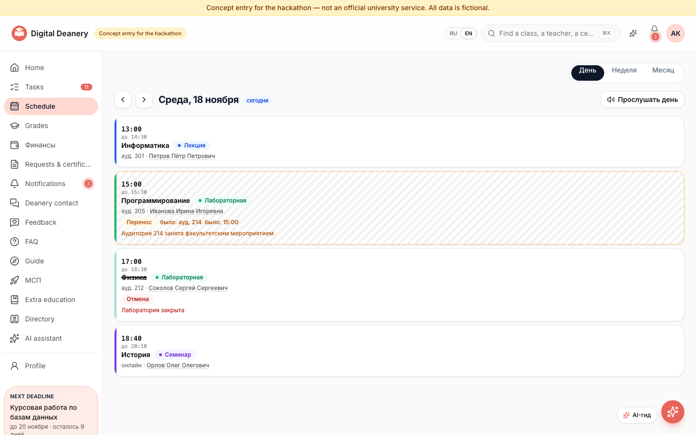
*The schedule: the lesson feed and the details panel with rescheduling badges*

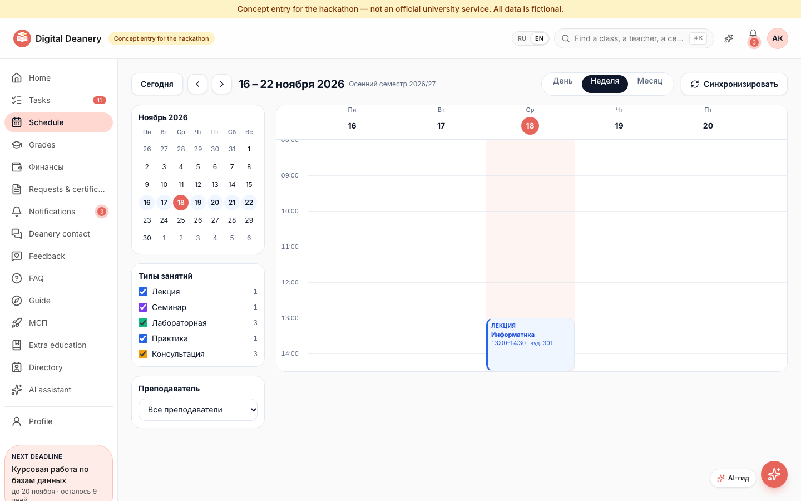
*The week: a Google-Calendar-style grid with drag-scrolling*

### 4.3. Calendar subscription (ICS)

On **Grades → Session** — an ICS link: subscribe to the schedule and deadlines in your system calendar (Apple Calendar, Google Calendar). The URL contains a personal token — do not share it with third parties; revoke it in settings.

## 5. Performance (/grades)

**Purpose.** The full academic picture: the average grade and credits, the grade dynamics explained by AI, the gradebook and the exam session schedule.

**How to use it (step by step):**

1. Open **«Grades»** — the summary shows the GPA ring, credits out of 240 and the group rating («top N%» — click expands the formula).
2. Check the **debts traffic light**: green — everything is done, red — a retake is required (click leads to the discipline).
3. On the **«What changed»** card study the AI breakdown: how your average moved over the month and which works moved it; the chart points are clickable.
4. Open the **gradebook**: all disciplines with grades/debts; a discipline click shows the control plan (test / lab / exam).
5. The **«Session»** tab: consultations, exams, retakes with the admission status; the ICS subscription link is there too.
6. Found an error in a grade? The **«Write to the deanery»** link creates a ticket with the context attached.

- **Summary**: a GPA ring (the credit-weighted average), credits (of 240), the group rating («top N%», the formula expands), a debts traffic light, an empty-state hint about the first credit test.
- **AI dynamics** (the «What changed» card): an explanation of how your average moved over the month, an interactive chart with per-date points and a breakdown of the works that moved the grade. Fully offline — no external services.
- **Gradebook**: all disciplines with grades/debts; a discipline card — the control plan (test / lab / exam items).
- **Session**: consultations, exams, retakes with the admission status.

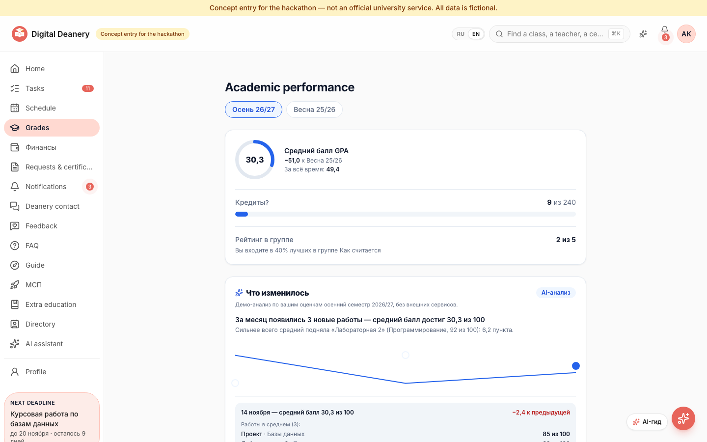
*Performance: the GPA ring, credits, the group rating, the debts traffic light*

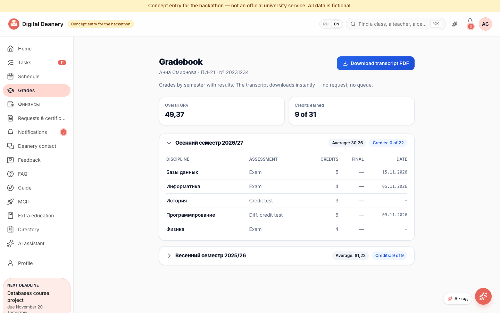
*The gradebook: disciplines with grades and control plans*

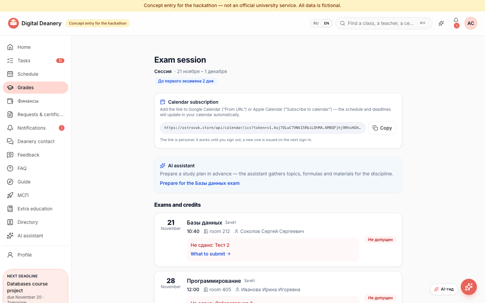
*The session: consultations, exams and retakes with admission*

## 6. Requests & certificates (/requests)

**Purpose.** Ordering certificates and other deanery documents via a 3-step wizard; tracking statuses; downloading a PDF with QR authenticity verification.

**How to order a certificate (step by step):**

1. Open **«Requests»** → **«New request»** (or «Order a certificate» from the home page / the services catalog).
2. **Step 1 «Type»** — pick a document, e.g. «Enrollment certificate · for a bank».
3. **Step 2 «Data»** — verify the pre-filled fields (name, group, gradebook); some purposes require an extra field.
4. **Step 3 «Confirmation»** — the request is created with a **ЗД-2026-XXXXXX** number (the canonical scheme) or an **SR-2026-XXXXX** service number.
5. Follow the status in the request list; a click opens the card with the full event history.
6. When the status is **«Ready»/«Issued»** — the card shows **«Download PDF»**: a document with a QR code and a verification code (verifiable by anyone on /verify/<code> without signing in).

### 6.1. The 3-step wizard

1. **Type** — pick a document (e.g. «Enrollment certificate · for a bank»).
2. **Data** — verify the pre-filled fields (name, group, gradebook); some purposes require an extra field.
3. **Confirmation** — the request gets a **ЗД-2026-XXXXXX** number (the canonical scheme) or an **SR-2026-XXXXX** service number.

### 6.2. Lifecycle

Statuses: **Submitted → Accepted → In progress → Ready → Issued**; side branches: **Needs a data fix** (the deanery awaits corrections — the card says what exactly), **Needs rework** (with the staff member's reason), **Rejected**, **Cancelled**. Every event lands in the card's history with the author and date. A status change triggers a notification on the channels you picked (push/e-mail/Telegram — simulated in the prototype).

### 6.3. PDF & authenticity

When the certificate is **Ready/Issued** — the card shows **«Download PDF»**. The PDF contains the document data, a QR code and a verification code. Anyone can verify authenticity on the public **/verify/<code>** page — without signing in. Re-generating yields the same code (the QR stays valid).

### 6.4. Limits

- Re-ordering the same certificate «for the same recipient» is blocked for 24 hours (the DIG-30 re-order window) — the wizard shows an honest warning.
- A document-level duplicate («for a bank» vs «for the draft board») is not blocked — different key values.

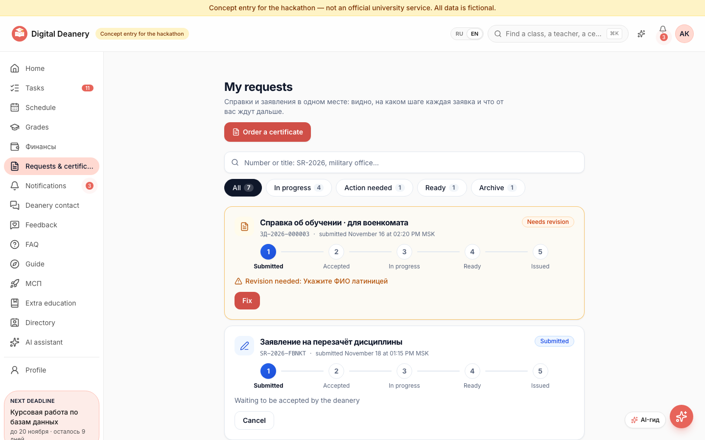
*Requests: lifecycle statuses and the new-request button*

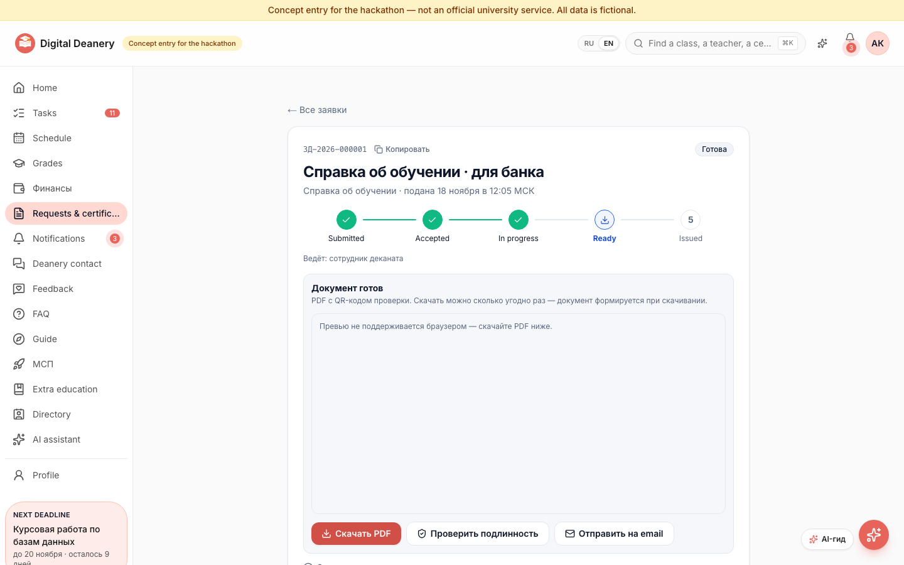
*The request card: the event history and «Download PDF» for a ready certificate*

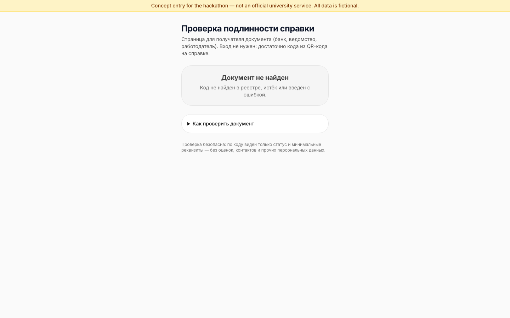
*The public /verify/&lt;code&gt; page: the QR and the code — no sign-in needed*

## 7. Deanery tickets (/deanery)

**Purpose.** A chat with the deanery manager on any academic topic — from the curriculum to an academic leave.

**How to open a ticket (step by step):**

1. Open **«Tickets»** → **«New ticket»**.
2. Pick a subject: curriculum / grades / transfer / academic leave / other.
3. Write the body, attach files if needed (file names) and send.
4. The ticket gets a **TS-2026-XXXXX** number and appears in the left list.
5. Wait for the manager's reply in the chat on the right; an unread reply is dotted in the list.
6. Opening the chat automatically marks the staff replies as read.

- The left column — your tickets with **TS-2026-XXXXX** numbers; the right — a chat with the manager.
- **A new ticket**: pick a subject (curriculum / grades / transfer / academic leave / other), the body, attachments (file names).
- The deanery manager replies in the chat; an unread reply is dotted in the list.
- Opening the chat marks the staff replies as read.

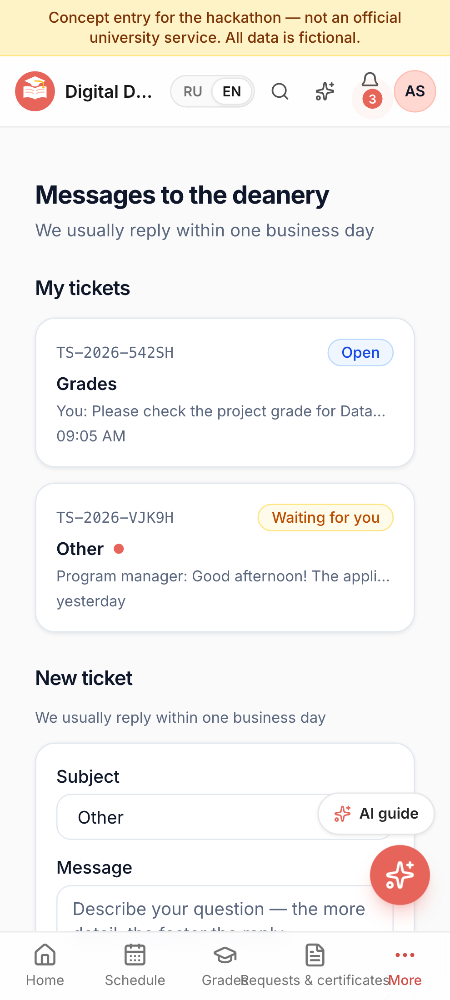
*Tickets: the list with TS-… numbers and the manager chat*

## 8. Feedback to the management (/feedback)

**Purpose.** A direct channel to the management: proposals, complaints and thank-yous — with an anonymous option.

**How to send (step by step):**

1. Open **«Feedback»** → **«New item»**.
2. Pick the **type**: Proposal / Complaint / Thank-you.
3. Pick the **recipient**: Deanery, Academic office, Program management, University management.
4. Write the body and attach files.
5. If needed, enable **«Anonymous»** — the author is hidden from the management (you keep the link to your item).
6. Send — the item appears in your list with a confirmation and a status.

- **Type**: Proposal / Complaint / Thank-you.
- **Recipient**: Deanery, Academic office, Program management, University management.
- **Body + attachments**, an **Anonymous** toggle — the author is hidden from the management (but you keep the link to your item).
- After sending — your list of feedback items and a card with the confirmation and status.

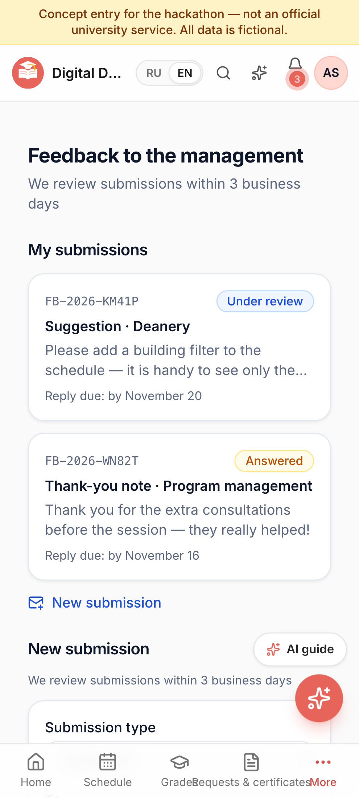
*Feedback: the type, the recipient, anonymity*

## 9. Tasks (/tasks)

**Purpose.** A personal task tracker: course deadlines arrive automatically, your own items are added manually — nothing gets lost.

**How to use it (step by step):**

1. Open **«Tasks»** — open items on top, completed ones hidden/below.
2. Add your own task: a title and a due date.
3. Automatic course deadlines arrive on their own — they can be marked done as well.
4. Tick a task done — the open counter updates.
5. The number of open tasks feeds the badge on the menu item and the sidebar pill.

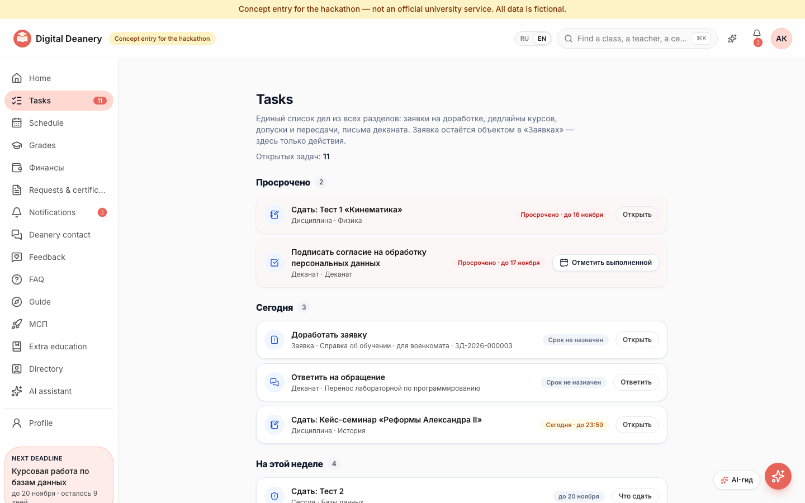
*Tasks: automatic course deadlines and your own items*

## 10. News (/news)

**Purpose.** The university news and announcements feed: stay informed without external chats.

**How to use it (step by step):**

1. Open **«News»** — the feed is sorted newest first.
2. Filter by categories (the pills on top).
3. Click a news item — the full page opens.
4. Read items are marked — the «Read» state persists across visits.

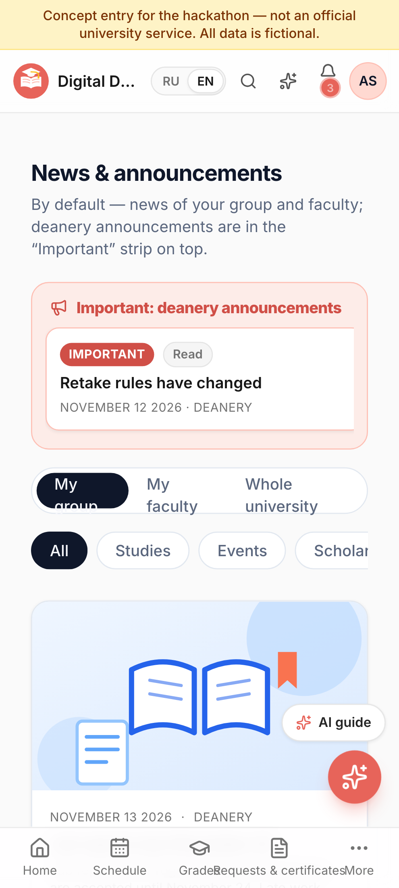
*News: categories and the «Read» marks*

## 11. Directory (/people)

**Purpose.** Teachers and staff of your faculty: contacts, disciplines and quick jumps from lesson cards.

**How to use it (step by step):**

1. Open **«Directory»** — the **«My teachers»** block is on top (those teaching your disciplines).
2. Search by name or discipline.
3. Click a person — the card: contacts, disciplines, the «Book a consultation» button (a stub).
4. On a lesson card in the schedule the teacher's name is clickable — it leads straight to the directory.

- **«My teachers»** — a personal block: those teaching your disciplines.
- **«Upcoming classes»** (staff only) — their schedule.
- A person card: contacts, disciplines, «Book a consultation» (a stub).
- On a lesson card the teacher's name is clickable and leads straight to the directory.

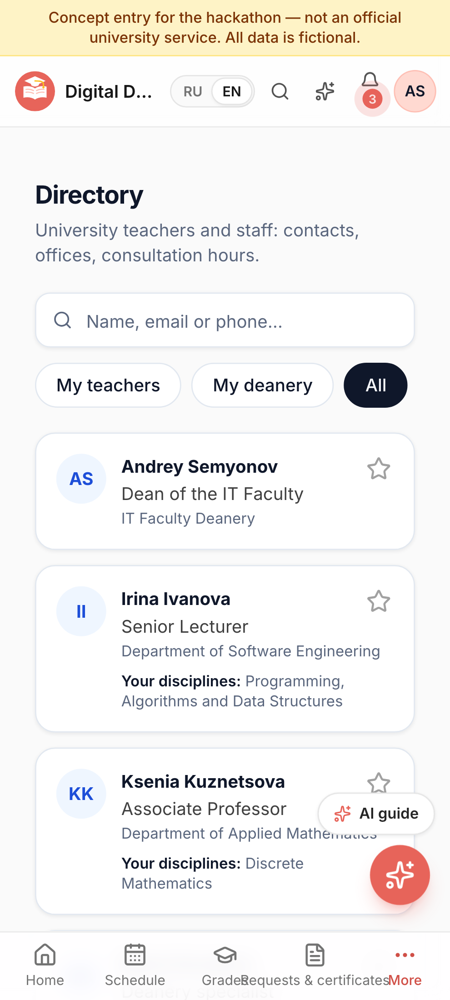
*The directory: «My teachers» and cards with contacts*

## 12. Events (/events)

**Purpose.** The faculty and university poster: lectures, hackathons, career days; one-click sign-up.

**How to sign up (step by step):**

1. Open **«Events»** — the poster is sorted by date.
2. Filter: «This week» / «Career» / «Online».
3. Press **«Sign up»** — your seat is fixed; the counter shows «N seats left».
4. Changed your mind — click again to cancel.
5. «No seats» disables the button; open the event card: description, date/venue or the stream link.

- **«Sign up»** — your seat is fixed; clicking again cancels. «N seats left»; «No seats» disables the button.
- An event card: description, date/venue or the stream link.

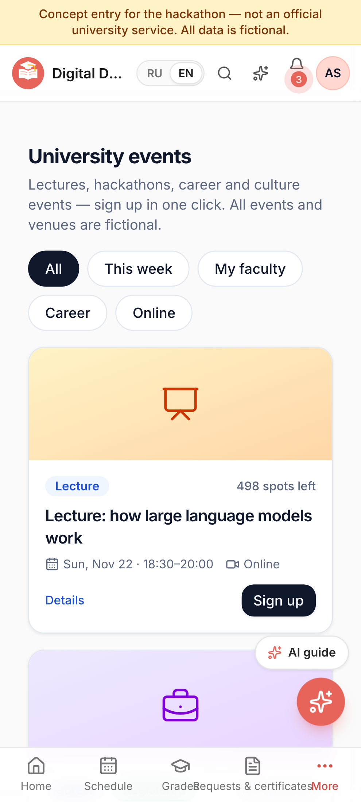
*The poster: the «This week / Career / Online» filters and the seat counters*

## 13. MSP — student startups (/msp)

**Purpose.** A student project catalog in the Product Hunt spirit: voting, «Launch of the day», publishing your own project.

**How to support a project (step by step):**

1. Open **«MSP»** — the card feed with vote counters; the «New» / «Top of the week» sortings.
2. Press **«▲ Support»** — one vote per project; clicking again removes it (only students vote).
3. Check **«Launch of the day»** — the project with the most votes.
4. Open the launch card: description, team, comments (you can reply).

**How to launch your own project (step by step):**

1. Press **«Launch a project»**.
2. Fill in: name, tagline, description, tags.
3. Publish — your project appears in the feed (the slug is auto-generated).

All projects are fictional — no real commerce.

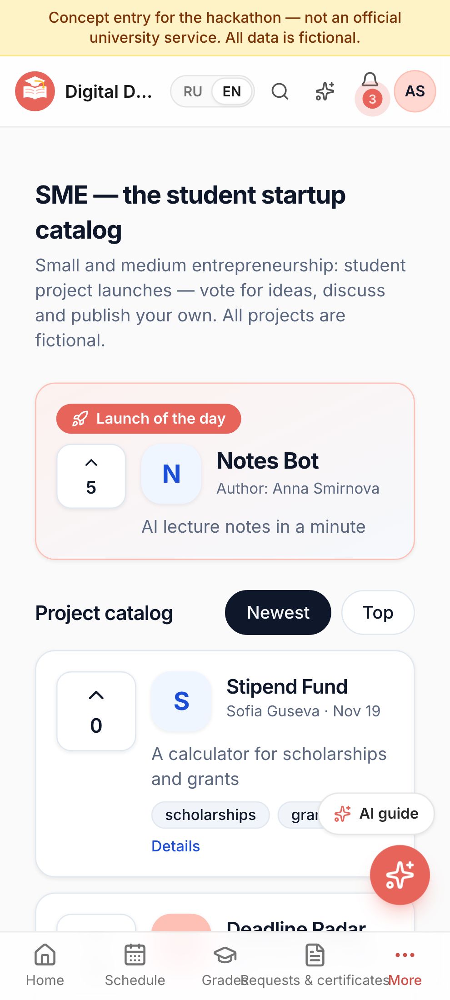
*MSP: the project feed, votes and «Launch of the day»*

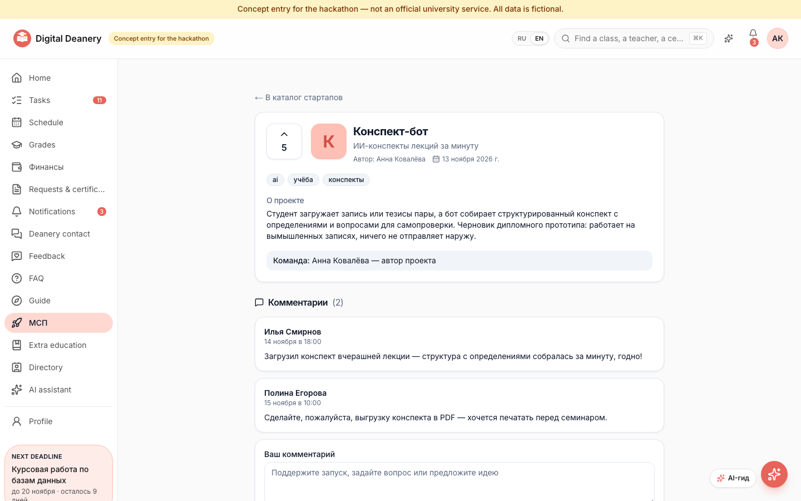
*The launch card: description, team and comments*

## 14. Additional education (/dpo)

**Purpose.** The catalog of additional-education programs: enroll, follow the progress, keep the documents.

**How to enroll (step by step):**

1. Open **«DPO»**, the **«Catalog»** tab.
2. Filter by format (online/on-site/hybrid), price and duration — the filters combine.
3. Press **«Enroll»** — the program appears in the **«My programs»** tab.
4. Follow the **progress bar** and the status (Active / Completed).
5. The **«Documents»** tab: contracts, acts, receipts, certificates; «Download» activates after graduation (a stub in the prototype).

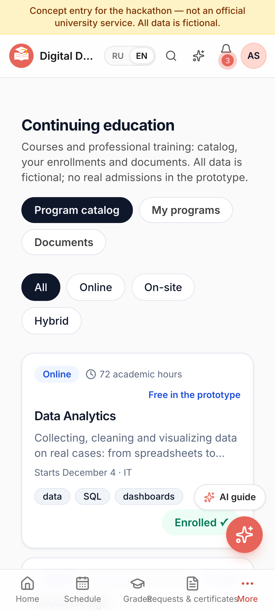
*DPO: the catalog with filters, «My programs» and documents*

## 15. Finance (/finance)

**Purpose.** The student's financial summary: the study form, the stipend, debts, contracts and payments.

**How to use it (step by step):**

1. Open **«Finance»** — the summary is on top: the study form (budget/contract), the stipend (kind, amount, next payout date), debts or «none».
2. Check the contracts and payments list.
3. Open the documents — receipts and certificates.

No real payments in the prototype — demonstration data only.

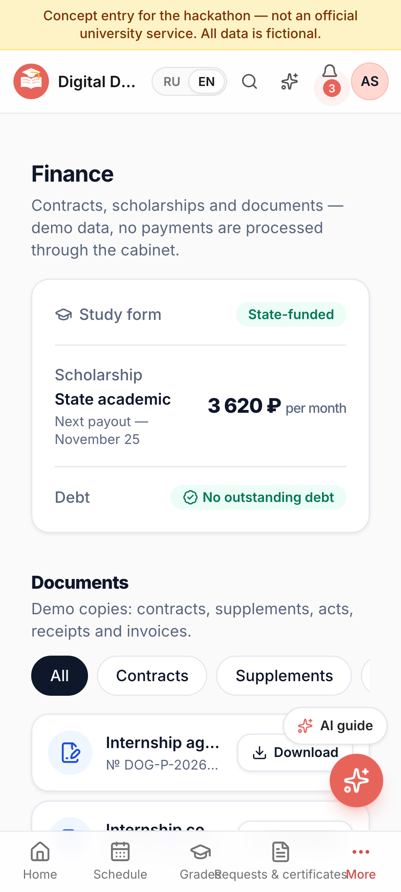
*Finance: the study form, the stipend, contracts and payments*

## 16. FAQ (/help) and the Guide (/guide)

**Purpose.** Self-service: short answers to frequent questions and a detailed guide to every section of the portal.

**How to find an answer (step by step):**

1. Open **«Help»** (/help) — the FAQ by categories.
2. Type a query into the question search.
3. No answer? Press **«Didn't find one»** — the question is forwarded to a deanery ticket or to the AI assistant.
4. For detailed instructions open **«Guide»** (/guide): a TOC, search and step-by-step walkthroughs for every section (the extended version is this document).

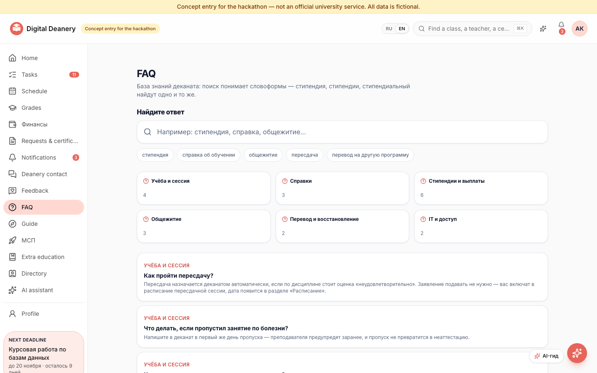
*The FAQ: categories and search; «Didn't find one» forwards to a ticket*

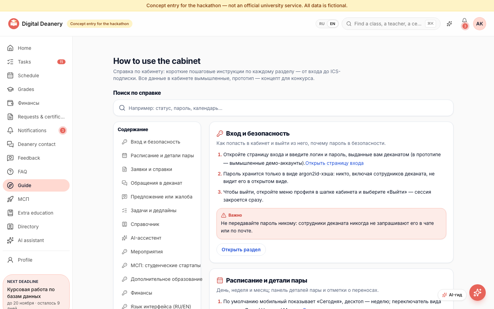
*The guide: a TOC and step-by-step instructions per section*

## 17. AI assistant (/ai-assistant)

**Purpose.** A helper for the portal: it answers questions about your studies from the built-in guide and supports voice input.

**How to ask (step by step):**

1. Open **/ai-assistant** or press the floating button (bottom-right) — a popup chat opens without leaving the current screen.
2. Pick a ready card («What is graded», «What about debts», «How to order a certificate»…) or ask your own question (up to 1000 characters).
3. The answer is grounded in the built-in portal guide (RAG): the assistant answers only from the official guide; if the data is missing it honestly suggests opening /guide or creating a ticket.
4. If the external AI is unavailable — the assistant works in demo mode showing a relevant guide chunk.
5. For dictation use the **microphone** in search and forms; schedule read-aloud is toggled by a flag in settings.

Limit: at most 10 questions per minute.

- **The /ai-assistant screen**: action cards, a chat with session history.
- **The floating button** (bottom-right): a popup chat.
- **Voice input**: a microphone in search and forms (dictation); schedule read-aloud is toggled by a flag in settings.
- **Grade dynamics AI** — a separate card on /grades (see section 5).

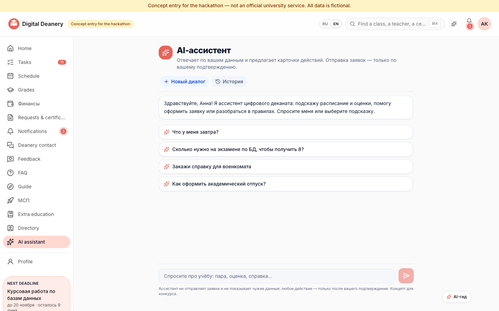
*The AI assistant: action cards and a chat with history*

## 18. Notifications (/notifications)

**Purpose.** The hub of portal events: schedule, grades, requests, news — with channel management and quiet hours.

**How to use it (step by step):**

1. Watch the **bell** in the header — the unread counter; a click opens the panel of the latest 5 notifications with deep links.
2. For the full feed open **/notifications**: mark-as-read, type filters (schedule, grades, requests, news, system, tasks, tickets).
3. **Configure the channels**: Settings → Notifications — the «category × channel» matrix (push/e-mail/Telegram).
4. Set a **quiet window** (e.g. 22:00–08:00) — nothing disturbs you at night.

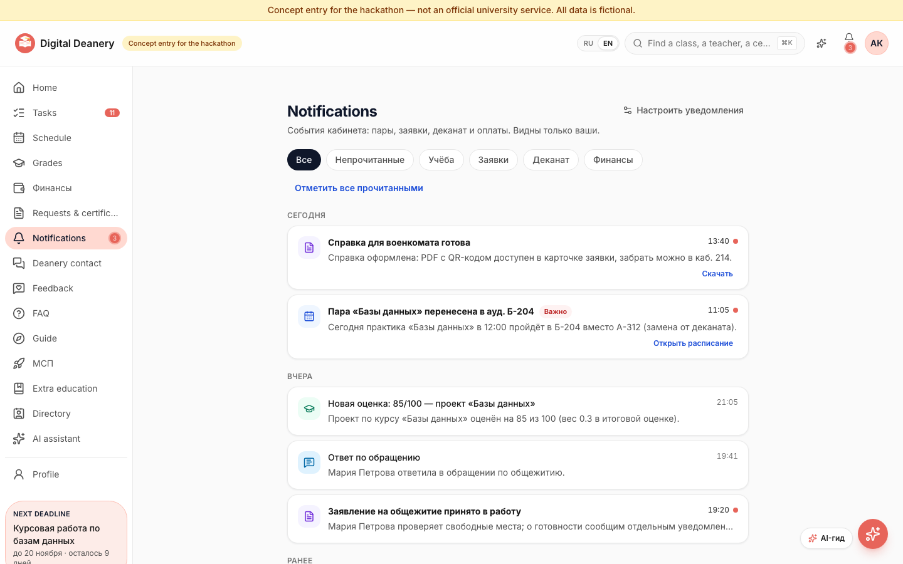
*Notifications: the full feed, type filters, mark-as-read*

## 19. Search (⌘K / Ctrl+K)

**Purpose.** Global portal search — find a section, a request by number, an event or a guide article in seconds.

**How to use it (step by step):**

1. Press **⌘K / Ctrl+K** or the magnifier button in the header.
2. Start typing: sections, requests by number (ЗД-…/SR-…), events, the guide.
3. Pick a result with the arrows and Enter — navigation; works on mobile too.

## 20. Profile (/profile)

**Purpose.** Your academic data maintained by the deanery (name, group, gradebook — read-only) and the contacts you edit yourself.

**How to use it (step by step):**

1. Open **«Profile»** from the avatar menu in the header.
2. Verify the data: program, year, study form, academic period — only the deanery changes those.
3. The gradebook number is shown **masked** — data protection on screen.
4. Edit the **contacts** (e-mail, phone) and save — the changes apply instantly.
5. Found an error in the data? Press **«Report a data error»** — a deanery ticket with the profile context is created.

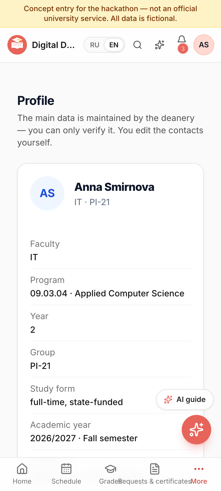
*The profile: read-only academic data, the masked gradebook, contact editing*

## 21. Settings (/settings)

**Purpose.** Portal personalization: home widgets, notification channels, security, an MCP token for external AI assistants, theme and language.

**How to use it (step by step):**

1. Open **«Settings»** from the avatar menu.
2. **Home**: drag the widgets into the order you like, disable the extras.
3. **Notifications**: for each category pick the channels (push/e-mail/Telegram) and set quiet hours.
4. **Security**: change the password (with the current one), review the active sessions — revoke any.
5. **MCP token**: issue a personal token to connect the portal to external AI assistants (Claude, ChatGPT) — grades, schedule, requests (details: docs/mcp.md).
6. **Theme**: light / dark / system. **Language**: RU/EN (duplicates the header switch).

| Tab | What is configurable |
|---|---|
| Home | The order and visibility of the home widgets (a drag list) |
| Notifications | The «category × channel» matrix (push/e-mail/Telegram), quiet hours |
| Security | Password change (with the current one), active sessions with revocation |
| MCP token | A personal token to connect the portal to external AI assistants (Claude, ChatGPT): grades, schedule, requests |
| Theme | Light / dark / system |
| Language | RU/EN (duplicates the header switch) |

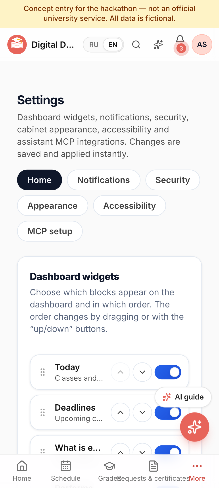
*Settings: the widgets, notifications, security and theme tabs*

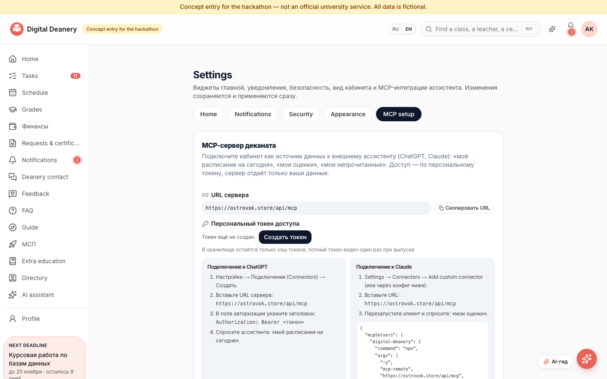
*The «MCP setup» tab: issuing a token and ready-made JSON configs for clients*

## 22. For the deanery staff (/staff)

**Purpose.** The staff workplace: the request queue with SLA, student tickets, announcements and the faculty summary.

**How to process a request (step by step):**

1. Sign in on the same /login screen as `dean.kovaleva` — the **deanery cabinet** opens (students cannot access it: any /staff* path returns HTTP 403).
2. Open the **request queue** (/staff/requests): your faculty's requests by status, overdue ones highlighted by SLA (3 days to respond).
3. Filter by type and deadline, press **«Take into work»**.
4. In the request card: the student data and parameters, the event history.
5. Walk the request through the allowed transitions: Accept → In progress → Ready → Issued; the «Data fix» / «Needs rework» / «Reject» / «Cancel» branches require a reason ≥ 5 characters.
6. For a completed certificate press **«Generate PDF»** — a document with QR verification.
7. A status change is instantly visible to the student; the notification is sent automatically.

- **Tickets** (/staff/appeals): faculty incoming, a chat with reply templates, «Resolved».
- **Announcements**: publish an announcement to a faculty or group, with a preview.
- **Summary**: requests today, average response time, overdue.

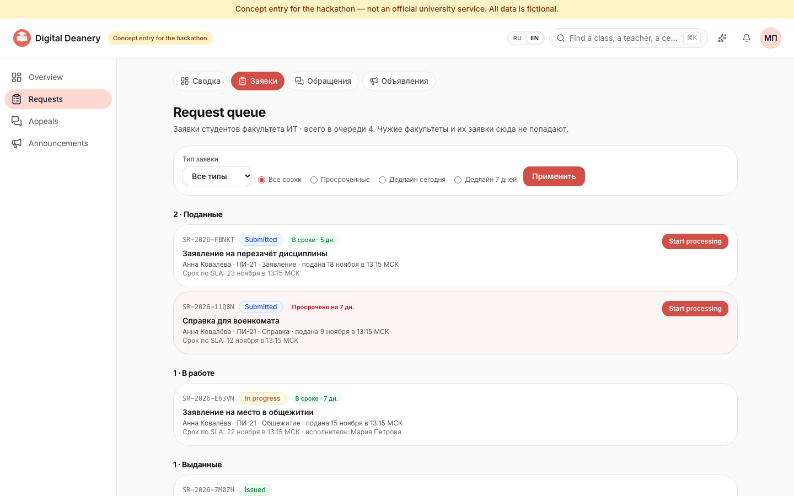
*The queue: statuses, SLA highlighting of overdue items, «Take into work»*

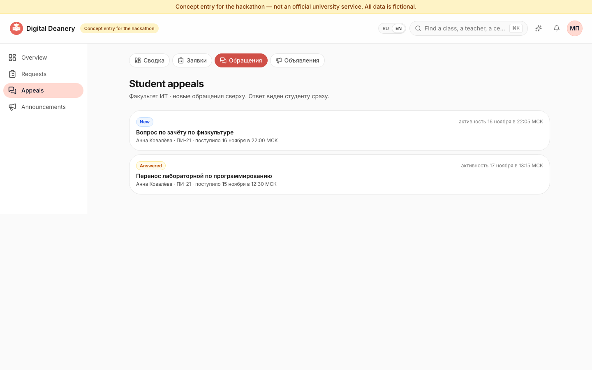
*Tickets: a chat with reply templates and «Resolved»*

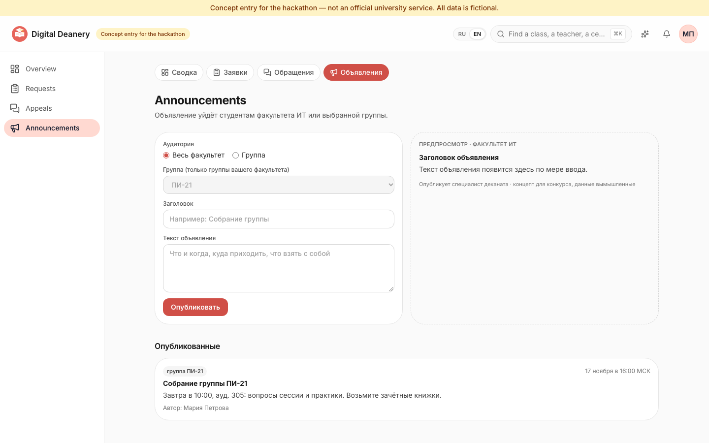
*Announcements: publishing to a faculty/group with a preview*

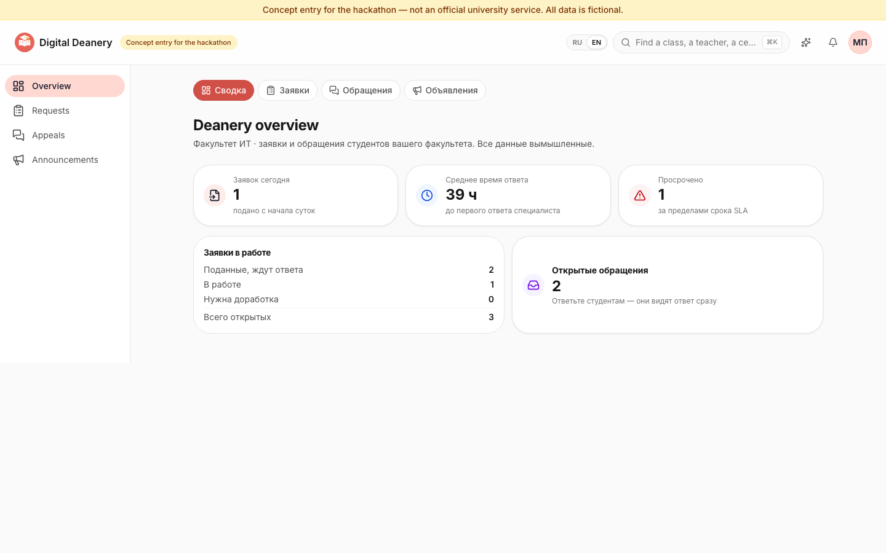
*The summary: requests today, average response time, overdue*

## 23. Mobile version

**Purpose.** The full portal on a phone from 360 px — every feature is one thumb away.

- The bottom tab bar: **Home, Schedule, Grades, Requests, More**; «More» opens the full section list.
- The lesson-details side panel becomes a **bottom sheet**; forms and chats are full-screen.
- Every screen is verified at **360×800** and **1440×900**.

## 24. Prototype limitations

- All data is fictional; there is no real enrollment, payment or university integration.
- Voice input/read-aloud depends on browser support (Chrome — yes, Firefox — partially).
- The AI assistant is limited to the portal guide and does not answer general questions.
