# Руководство пользователя (RU)

> «Цифровой деканат» — личный кабинет студента. **Концепт для конкурса**: все данные вымышленные. Прод: https://ostrovok.store
>
> **Языки:** интерфейс доступен на русском и английском — переключатель **RU | EN** в правой части шапки. Выбор сохраняется между визитами.
>
> Каждая глава построена одинаково: **назначение** экрана, **пошаговая инструкция**, **скриншот** (мобильный 360 px / десктоп 1440 px) и описание элементов экрана.

## Оглавление

1. [Вход и безопасность](#1-вход-и-безопасность)
2. [Главная (/dashboard)](#2-главная-dashboard)
3. [Каталог сервисов (/services)](#3-каталог-сервисов-services)
4. [Расписание (/schedule)](#4-расписание-schedule)
5. [Успеваемость (/grades)](#5-успеваемость-grades)
6. [Заявки и справки (/requests)](#6-заявки-и-справки-requests)
7. [Обращения в деканат (/deanery)](#7-обращения-в-деканат-deanery)
8. [Обратная связь руководству (/feedback)](#8-обратная-связь-руководству-feedback)
9. [Задачи (/tasks)](#9-задачи-tasks)
10. [Новости (/news)](#10-новости-news)
11. [Справочник (/people)](#11-справочник-people)
12. [Мероприятия (/events)](#12-мероприятия-events)
13. [МСП — студенческие стартапы (/msp)](#13-мсп--студенческие-стартапы-msp)
14. [Доп. образование (/dpo)](#14-доп-образование-dpo)
15. [Финансы (/finance)](#15-финансы-finance)
16. [Вопросы и ответы (/help) и Справка (/guide)](#16-вопросы-и-ответы-help-и-справка-guide)
17. [AI-ассистент (/ai-assistant)](#17-ai-ассистент-ai-assistant)
18. [Уведомления (/notifications)](#18-уведомления-notifications)
19. [Поиск (⌘K / Ctrl+K)](#19-поиск--k--ctrlk)
20. [Профиль (/profile)](#20-профиль-profile)
21. [Настройки (/settings)](#21-настройки-settings)
22. [Сотруднику деканата (/staff)](#22-сотруднику-деканата-staff)
23. [Мобильная версия](#23-мобильная-версия)
24. [Ограничения прототипа](#24-ограничения-прототипа)

## 1. Вход и безопасность

**Назначение.** Лендинг рассказывает, что умеет кабинет; форма входа открывает доступ к личным данным — студенческим или сотрудническим в зависимости от роли.

### 1.1. Как войти (пошагово)

1. Откройте https://ostrovok.store — попадёте на лендинг с описанием возможностей.
2. Нажмите **«Войти в кабинет»** — откроется форма входа.
3. Введите логин и пароль (для жюри — демо-аккаунты из таблицы ниже) или воспользуйтесь кнопками быстрого входа под формой.
4. Нажмите **«Войти»**. После успешного входа откроется **/dashboard** (студент) или **/staff** (сотрудник).

| Роль | Логин | Пароль | Кто это |
|---|---|---|---|
| Студент | `anna.smirnova` | `anna-demo-2026` | Анна Смирнова, 2 курс ПИ-21: хорошая успеваемость, заявки в работе |
| Студент | `ilya.petrov` | `ilya-demo-2026` | Илья Петров, 1 курс ЭК-11: переносы пар, перезачёт и практика в работе |
| Сотрудник | `dean.kovaleva` | `dean-demo-2026` | Мария Ковалёва, деканат факультета ИТ (кабинет `/staff`) |

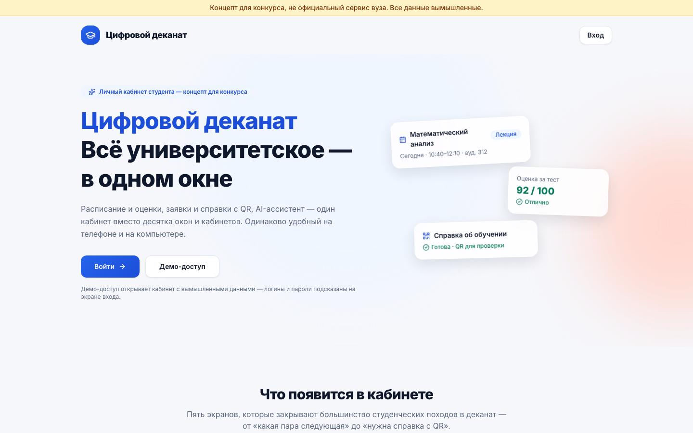
*Лендинг с описанием возможностей и кнопкой «Войти в кабинет»*

### 1.2. Защита входа

- **Ограничение попыток:** не более 30 попыток входа за 15 минут с одного IP; при превышении — сообщение «Слишком много попыток, подождите N минут».
- **Блокировка аккаунта:** после 5 неверных паролей подряд аккаунт временно блокируется.
- **Сессии:** вход создаёт сессию на 30 дней; в **Настройки → Безопасность** виден список активных сессий (устройство, IP, дата) — любую можно отозвать.
- **Выход:** кнопка «Выйти» в меню профиля — сессия и обе куки (`__Host-session`, `__Host-role`) удаляются, вы попадаете на экран «Вы вышли из кабинета».
- **Восстановление пароля:** ссылка «Забыли пароль?» — заглушка прототипа (реальная отправка писем не входит в концепт).

### 1.3. Изоляция данных

Кабинет показывает **только ваши данные**: чужие заявки, обращения и оценки технически недоступны — любой запрос «чужого» объекта возвращает единый 404, а попытка фиксируется в журнале аудита. Раздел «Найти ошибку в оценке? Написать в деканат» на странице успеваемости — легальный способ сообщить о расхождении.

## 2. Главная (/dashboard)

**Назначение.** Стартовый экран-сводка: что происходит сегодня, как обстоят дела с успеваемостью и заявками, куда перейти в первую очередь.

**Как пользоваться (пошагово):**

1. Войдите в кабинет — вы попадёте на /dashboard автоматически.
2. Прочитайте **hero «Ваша неделя»**: сводка дня (перенесено/отменено/до пересдачи) и плитки GPA, кредиты, долги, заявки.
3. Проверьте виджеты **«Сегодня»** и **«Дедлайны»** — что требует внимания прямо сейчас.
4. Пользуйтесь **быстрыми действиями**: «Заказать справку» и «Написать в деканат» — они открывают мастера заявки и форму обращения.
5. Если порядок блок не устраивает — **Настройки → Виджеты** (перетаскивание, включение/выключение).
6. Свежие события — в панели колокольчика; «Все уведомления» — полный центр.

- **Hero «Ваша неделя»**: приветствие с датой, сводка дня (перенесено/отменено/до пересдачи), плитки-ссылки: Средний балл (GPA), Кредиты (из 240), Долги (требуется пересдача / всё сдано), Заявки в работе.
- **Быстрые действия**: «Заказать справку», «Написать в деканат».
- **Виджеты** (порядок и включённость настраиваются в Настройки → Виджеты): Сегодня (пары с пометками переноса/отмены), Дедлайны, Задачи, Успеваемость, Заявки, Новости, Мероприятия.
- **Последние уведомления**: панель колокольчика дублирует свежие события; «Все уведомления» — полный центр.
- **Настроить уведомления** — прямая ссылка на настройки уведомлений.

Плитки и блоки кликабельны — каждый ведёт в соответствующий раздел.

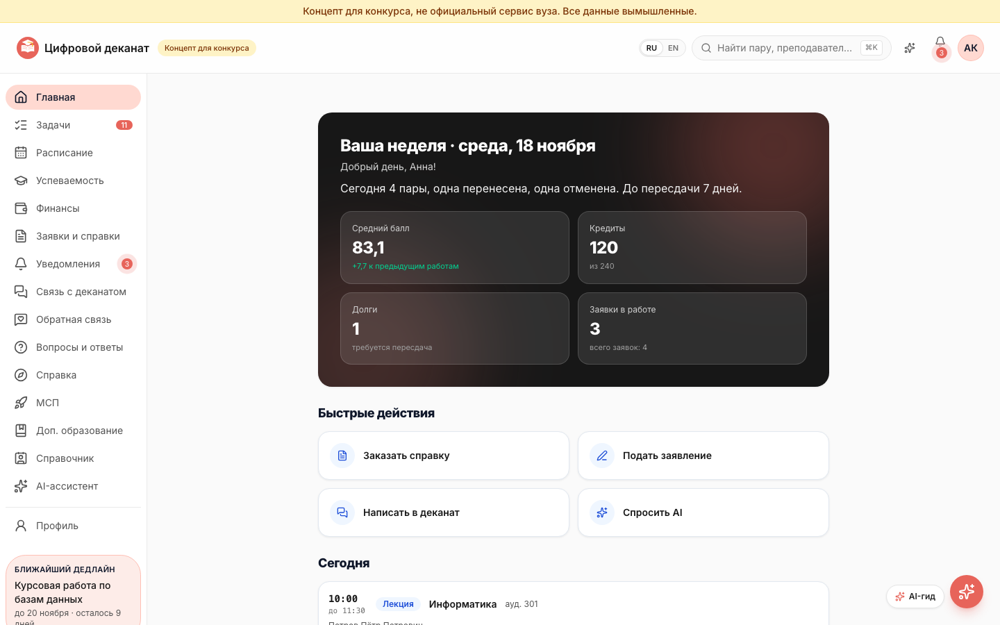
*Главная: hero «Ваша неделя», плитки GPA/кредиты/долги/заявки, виджеты*

## 3. Каталог сервисов (/services)

**Назначение.** Каталог услуг деканата и вуза, персонально отфильтрованный под вашу роль и курс: быстро найти нужную услугу и сразу перейти к её оформлению.

**Как пользоваться (пошагово):**

1. Откройте раздел **«Сервисы»** в меню кабинета.
2. Отфильтруйте каталог **категориями-пилюлями** (шесть категорий) — список сужается мгновенно.
3. Закрепите часто нужную услугу в **«Избранное и часто используемые»** (до 6 закреплений; хранится на сервере и переносится между устройствами).
4. Блок **«Часто нужно на N курсе»** предлагает услуги без дублей с избранным — ориентируйтесь на него, если не знаете, что искать.
5. Клик по карточке сервиса открывает мастер заказа заявки (см. раздел 6) с предзаполненным типом документа.

Сотруднику каталог показывает пустое состояние — услуга персональная, доступ студенту.

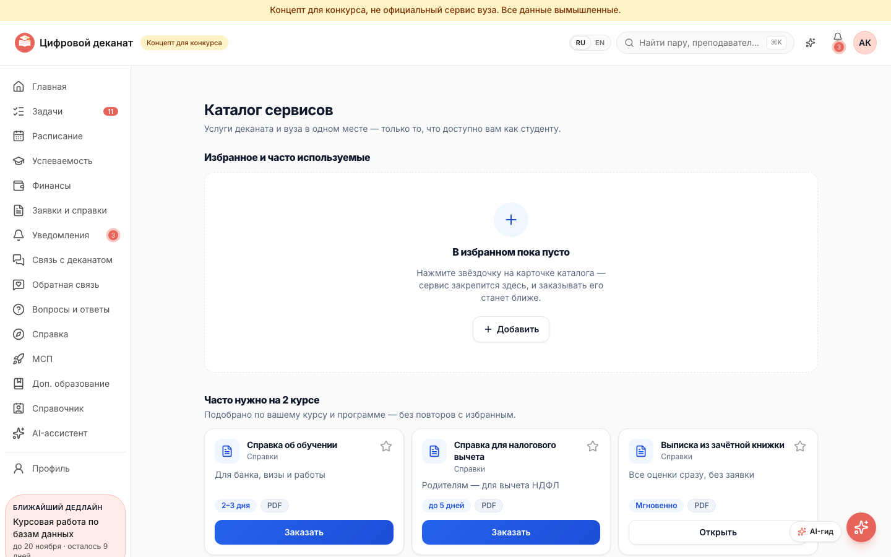
*Каталог сервисов: категории, избранное, «часто нужно на курсе»*

## 4. Расписание (/schedule)

**Назначение.** Пары на день, неделю и месяц; детали пары с домашним заданием, материалами и пометками о переносах и отменах.

**Как пользоваться (пошагово):**

1. Откройте **«Расписание»** — по умолчанию вид **«День»**; переключайте День/Неделя/Месяц вкладками сверху.
2. В виде «День» кликните пару слева — справа откроется панель **«Детали пары»** (на мобильном — шторка снизу).
3. В панели: время с обратным отсчётом «до конца», аудитория или онлайн-ссылка, преподаватель (кликабелен → карточка в Справочнике), домашнее задание и материалы.
4. Для вида **«Неделя»** прокручивайте сетку drag-жестом (в стиле Google Calendar); компактный режим уменьшает карточки.
5. Закройте панель крестиком или Esc — фокус вернётся на карточку пары.
6. Даты переносов и отмен ищите по бейджам: **штриховка + причина** = перенос, **зачёркнутое название** = отмена.

### 4.1. Виды

- **День**: лента пар слева, справа (desktop) — панель **«Детали пары»** выбранной пары.
- **Неделя**: сетка в стиле Google Calendar с drag-прокруткой (DIG-28) и компактным режимом.
- **Месяц**: компактный обзор; мобильный вид — вертикальная лента.

### 4.2. Детали пары

Клик по паре → боковая панель: время (с «до конца» в реальном времени), аудитория/онлайн-ссылка, преподаватель (имя — ссылка на его карточку в Справочнике), домашнее задание и материалы, **заметные бейджи** переноса (штриховка + причина) и отмены (зачёркнутое название). Панель закрывается крестиком или Esc; при закрытии фокус возвращается на карточку пары.

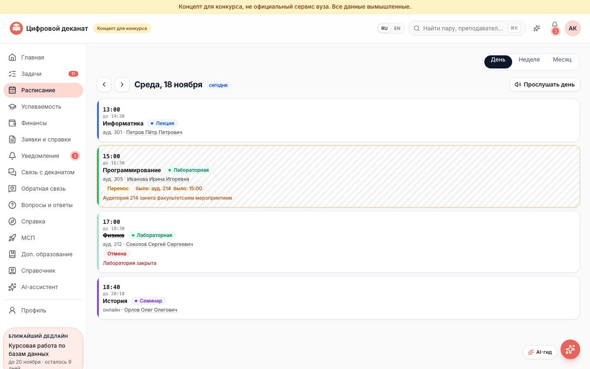
*Расписание: лента пар и панель «Детали пары» с бейджами переноса*

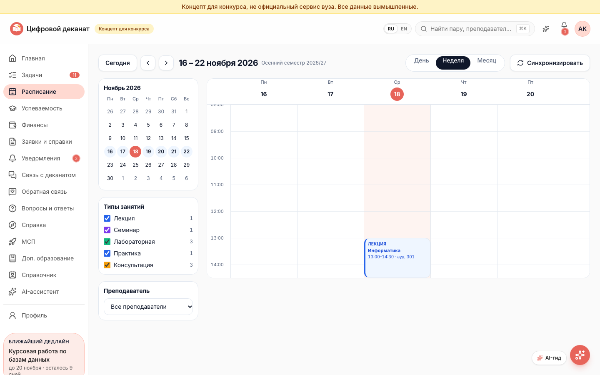
*Неделя: сетка в стиле Google Calendar с drag-прокруткой*

### 4.3. Подписка на календарь (ICS)

На странице **Успеваемость → Сессия** — ссылка на ICS-файл: подпишите расписание и дедлайны в системный календарь (Apple Calendar, Google Calendar). URL содержит персональный токен — не передавайте его третьим лицам; отзыв — в настройках.

## 5. Успеваемость (/grades)

**Назначение.** Полная картина учёбы: средний балл и кредиты, динамика оценок с объяснением AI, ведомость (зачётная книжка) и расписание сессии.

**Как пользоваться (пошагово):**

1. Откройте **«Оценки»** — на сводке кольцо GPA, кредиты из 240 и рейтинг в группе («в N% лучших» — клик раскрывает формулу).
2. Проверьте **светофор долгов**: зелёный — всё сдано, красный — требуется пересдача (клик ведёт к дисциплине).
3. На карточке **«Что изменилось»** изучите AI-разбор: как средний балл двигался за месяц, какие работы повлияли; точки графика кликабельны.
4. Откройте **«Ведомость»**: все дисциплины с оценками/долгами; клик по дисциплине — план контроля (тест/лабораторная/экзамен).
5. Вкладка **«Сессия»**: консультации, экзамены, пересдачи с отметкой допуска; там же — ссылка ICS-подписки.
6. Нашли ошибку в оценке? Ссылка **«Написать в деканат»** создаёт обращение с контекстом.

- **Сводка**: кольцо GPA (взвешенный кредитами средний балл), кредиты (из 240), рейтинг в группе («в N% лучших», раскрывается формула), светофор долгов, пустое состояние с подсказкой о первой контрольной.
- **AI-динамика** (карточка «Что изменилось»): объяснение движения среднего балла за месяц, интерактивный график с точками по датам и разбором работ, повлиявших на оценку. Полностью офлайн — без внешних сервисов.
- **Ведомость (Зачётная книжка)**: все дисциплины с оценками/долгами; карточка дисциплины — план контроля (элементы: тест/лабораторная/экзамен).
- **Сессия**: расписание консультаций, экзаменов, пересдач с допуском.

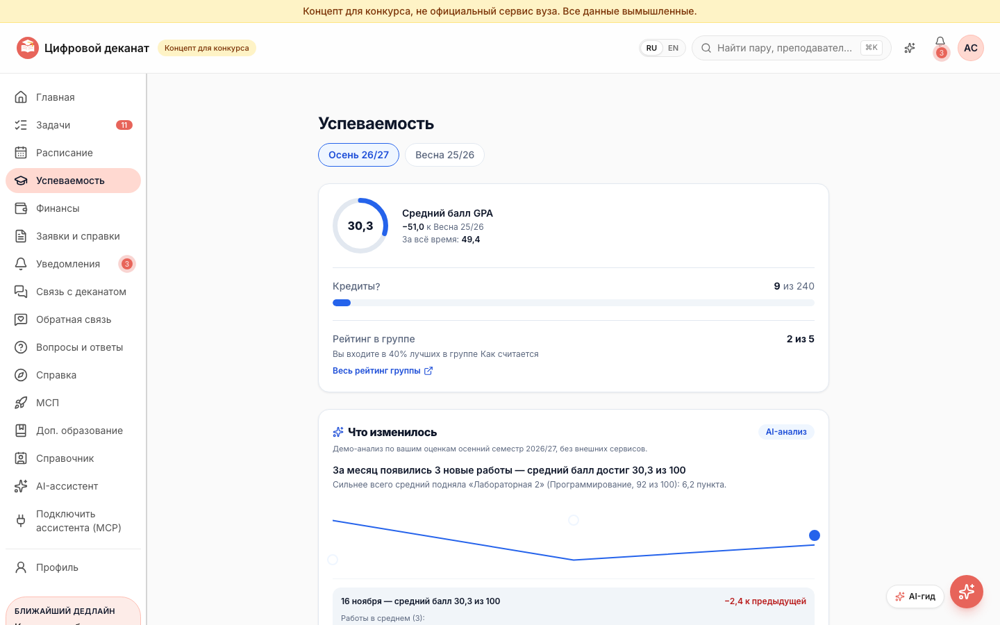
*Успеваемость: кольцо GPA, кредиты, рейтинг группы, светофор долгов*

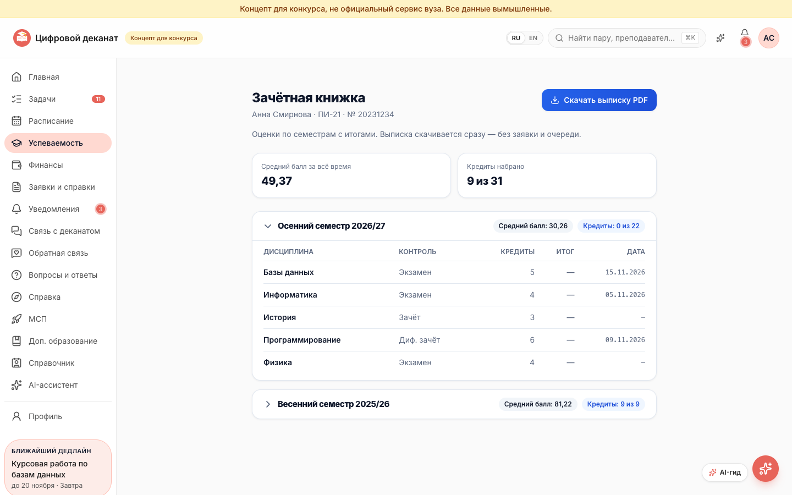
*Ведомость: дисциплины с оценками и планами контроля*

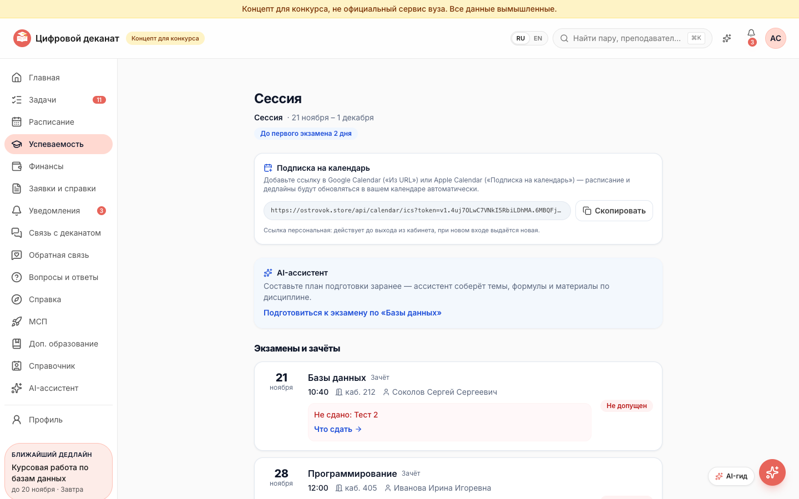
*Сессия: консультации, экзамены и пересдачи с допуском*

## 6. Заявки и справки (/requests)

**Назначение.** Заказ справок и других документов деканата через трёхшаговый мастер; отслеживание статусов; скачивание PDF с QR-проверкой подлинности.

**Как заказать справку (пошагово):**

1. Откройте **«Заявки»** → кнопка **«Новая заявка»** (или «Заказать справку» с главной/каталога сервисов).
2. **Шаг 1 «Тип»** — выберите документ, например «Справка об обучении · для банка».
3. **Шаг 2 «Данные»** — проверьте предзаполненные поля (ФИО, группа, зачётка); для «военкомата» может требоваться дополнительное поле.
4. **Шаг 3 «Подтверждение»** — заявка создана, присвоен номер **ЗД-2026-XXXXXX** (каноническая схема) или **SR-2026-XXXXX** (сервисная).
5. Следите за статусом в списке заявок; клик по заявке — карточка с полной историей событий.
6. Когда статус **«Готова»/«Выдана»** — в карточке появится **«Скачать PDF»**: документ с QR-кодом и кодом проверки (проверка любым человеком на /verify/<код> без входа).

### 6.1. Мастер заказа (3 шага)

1. **Тип** — выберите документ (например, «Справка об обучении · для банка»).
2. **Данные** — проверьте предзаполненные поля (ФИО, группа, зачётка); для «военкомата» может требоваться дополнительное поле.
3. **Подтверждение** — заявке присваивается номер **ЗД-2026-XXXXXX** (каноническая схема) или **SR-2026-XXXXX** (сервисная).

### 6.2. Жизненный цикл

Статусы: **Подана → Принята → В работе → Готова → Выдана**; особые ветки: **Нужна правка** (деканат ждёт исправления данных — в карточке указано что именно), **Нужна доработка** (с причиной от сотрудника), **Отклонена**, **Отменена**. Каждое событие — в истории карточки с автором и датой. Уведомление о смене статуса приходит на выбранные каналы (push/e-mail/Telegram — в прототипе имитируется).

### 6.3. PDF и проверка подлинности

Когда справка **Готова/Выдана** — в карточке появляется кнопка **«Скачать PDF»**. В PDF: данные документа, QR-код и код проверки. Любой человек может проверить подлинность на публичной странице **/verify/<код>** — без входа в кабинет. Повторное формирование отдаёт тот же код (QR остаётся действительным).

### 6.4. Ограничения

- Повторный заказ той же справки «для того же получателя» блокируется на 24 часа (окно повторного заказа DIG-30) — в мастере появится честное предупреждение.
- Дубликат по документу (та же справка «для банка» vs «для военкомата») не блокируется — это разные ключевые значения.

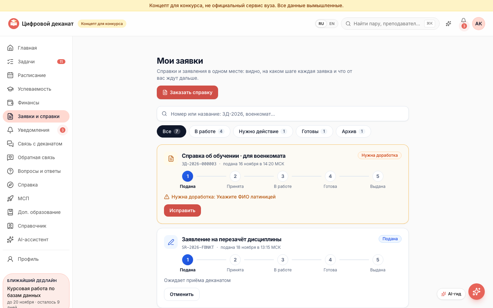
*Заявки: статусы жизненного цикла и кнопка новой заявки*

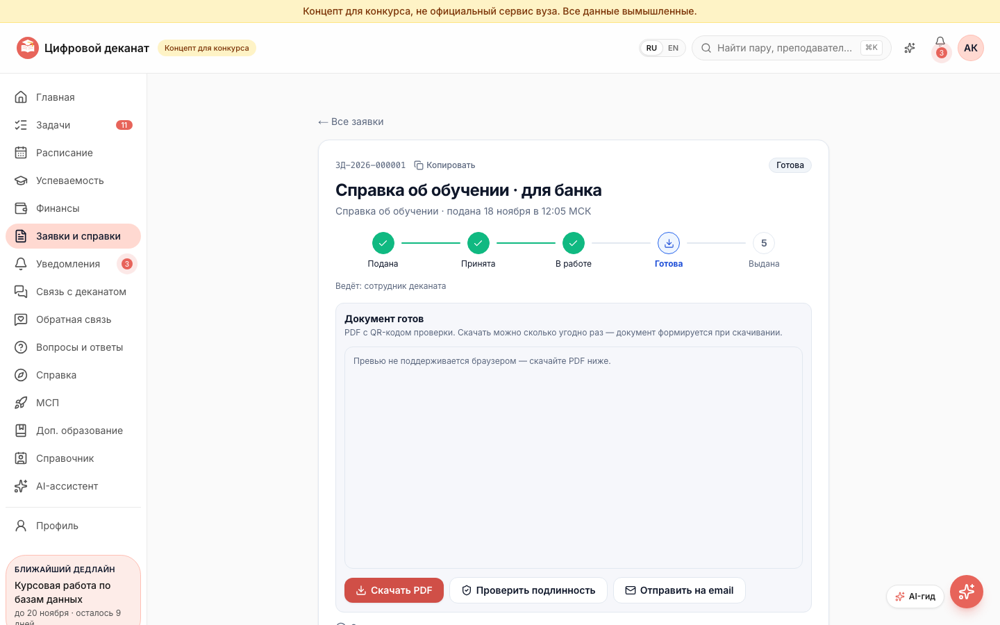
*Карточка заявки: история событий и «Скачать PDF» для готовой справки*

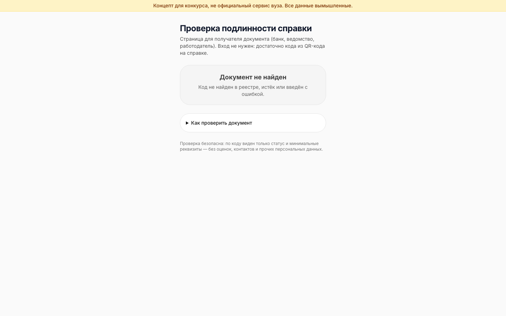
*Публичная проверка /verify/&lt;код&gt;: QR и код — без входа в кабинет*

## 7. Обращения в деканат (/deanery)

**Назначение.** Чат с менеджером деканата по любой учебной теме — от учебного плана до академического отпуска.

**Как написать обращение (пошагово):**

1. Откройте **«Обращения»** → **«Новое обращение»**.
2. Выберите тему: учебный план / оценки / перевод / академ. отпуск / другое.
3. Напишите текст, при необходимости приложите вложения (имена файлов) и отправьте.
4. Обращению присваивается номер **TS-2026-XXXXX** — оно появляется в списке слева.
5. Ждите ответ менеджера в чате справа; непрочитанный ответ подсвечен точкой в списке.
6. Открытие чата автоматически помечает ответы менеджера прочитанными.

- Слева — список ваших обращений с номерами **TS-2026-XXXXX**; справа — чат с менеджером.
- **Новое обращение**: выбор темы (учебный план / оценки / перевод / академ. отпуск / другое), текст, вложения (имена файлов).
- Менеджер деканата отвечает в чате; непрочитанный ответ подсвечен точкой в списке.
- Открытие чата помечает ответы менеджера прочитанными.

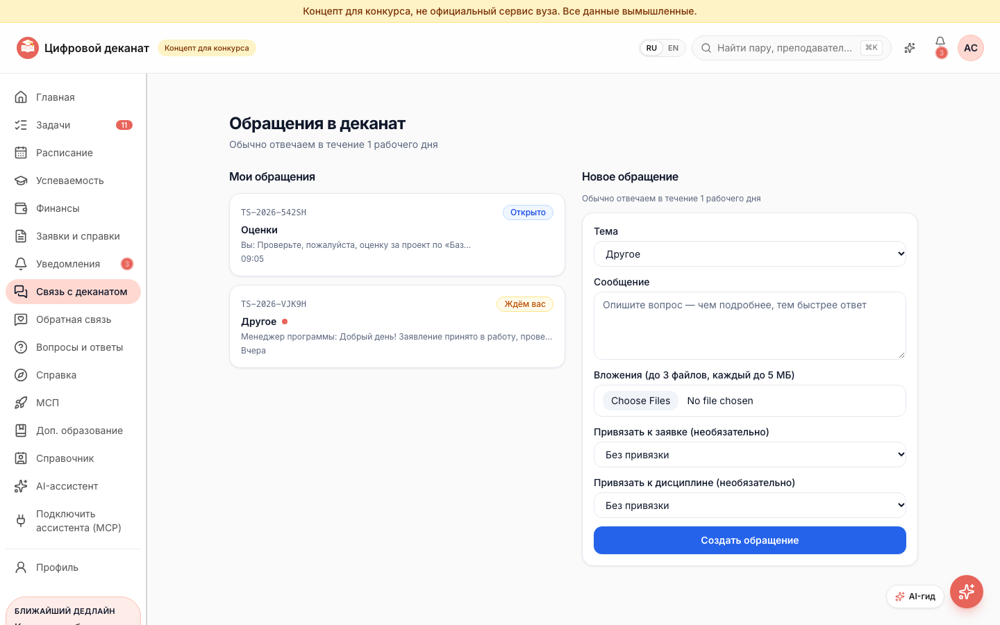
*Обращения: список с номерами TS-… и чат с менеджером*

## 8. Обратная связь руководству (/feedback)

**Назначение.** Прямой канал к руководству: предложения, жалобы и благодарности — с возможностью отправить анонимно.

**Как отправить (пошагово):**

1. Откройте **«Обратная связь»** → **«Новое обращение»**.
2. Выберите **тип**: Предложение / Жалоба / Благодарность.
3. Выберите **адресата**: Деканат, Учебный офис, Руководство программы, Руководство вуза.
4. Напишите текст, приложите вложения.
5. При необходимости включите **«Анонимно»** — автор скрыт от руководства (ссылка на обращение у вас сохраняется).
6. Отправьте — обращение появится в списке с подтверждением и статусом.

- **Тип**: Предложение / Жалоба / Благодарность.
- **Адресат**: Деканат, Учебный офис, Руководство программы, Руководство вуза.
- **Текст + вложения**, переключатель **«Анонимно»** — при включении автор скрыт от руководства (но ссылка на обращение у вас сохраняется).
- После отправки — список ваших обращений и карточка с подтверждением и статусом.

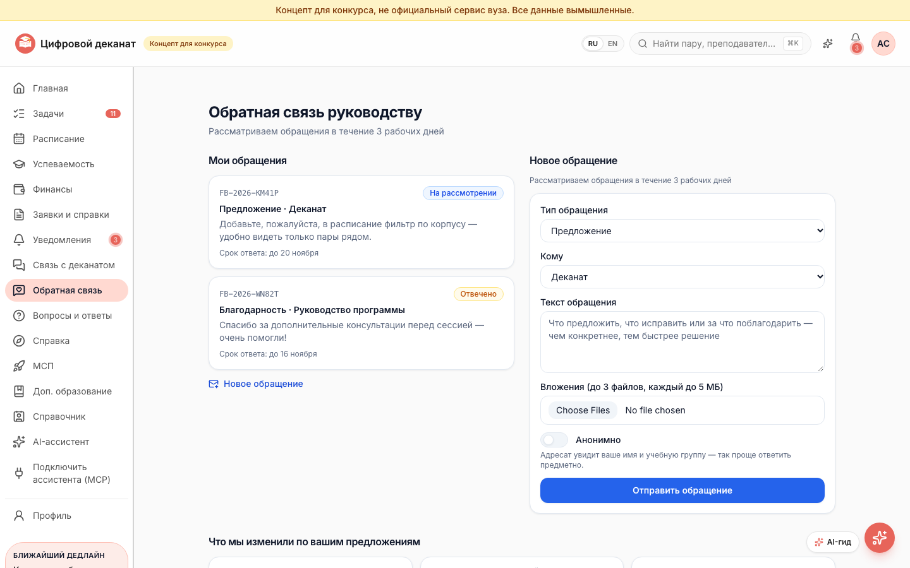
*Обратная связь: тип, адресат, анонимность*

## 9. Задачи (/tasks)

**Назначение.** Личный задачник: дедлайны курсов приходят автоматически, свои задачи вы добавляете сами; ничего не теряется.

**Как пользоваться (пошагово):**

1. Откройте **«Задачи»** — сверху открытые, выполненные скрыты/ниже.
2. Добавьте собственную задачу: название и срок.
3. Автоматические дедлайны курсов приходят сами — их можно отмечать выполненными.
4. Отметьте задачу выполненной галочкой — счётчик открытых обновится.
5. Число открытых задач показывается бейджем у пункта меню и пилюлей в сайдбаре.

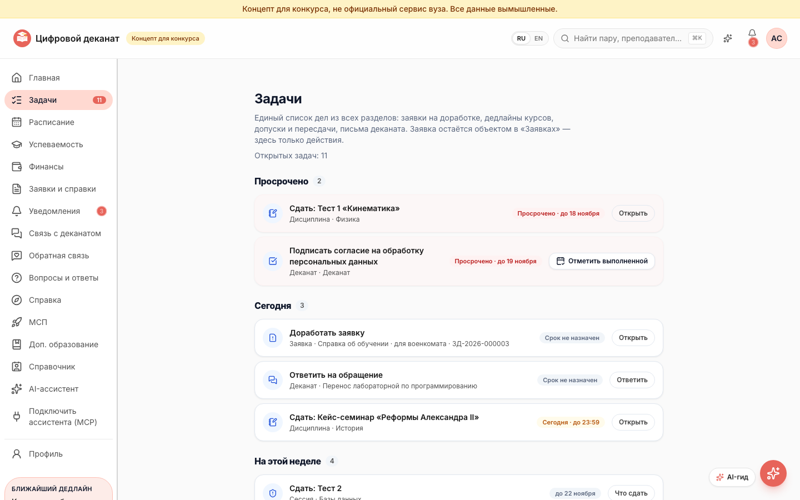
*Задачи: автоматические дедлайны курсов и собственные пункты*

## 10. Новости (/news)

**Назначение.** Лента университетских новостей и объявлений: быть в курсе событий вуза без внешних чатов.

**Как пользоваться (пошагово):**

1. Откройте **«Новости»** — лента отсортирована от свежих.
2. Фильтруйте по категориям (пилюли сверху).
3. Клик по новости — полная страница с текстом.
4. Прочитанные помечаются — отметка «Прочитано» сохраняется между визитами.

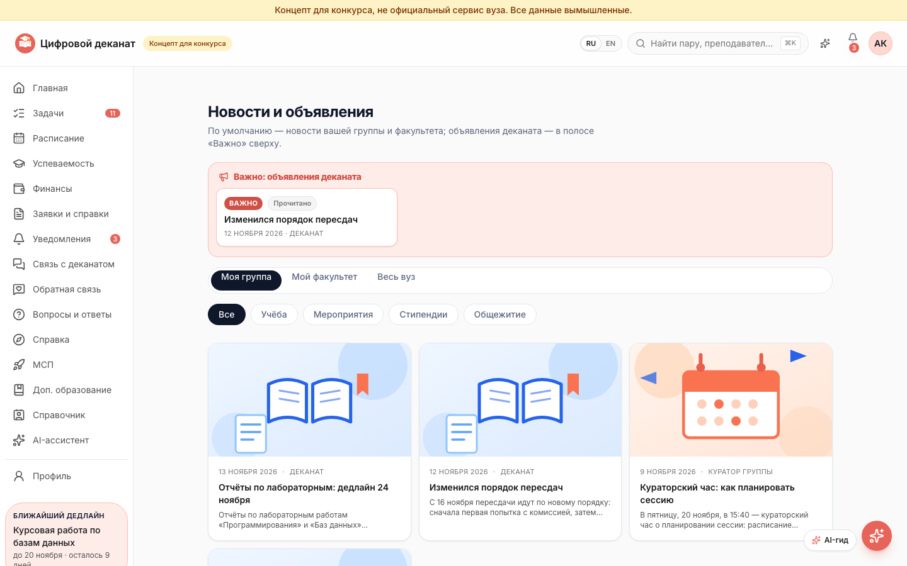
*Новости: категории и отметки «Прочитано»*

## 11. Справочник (/people)

**Назначение.** Преподаватели и сотрудники факультета: контакты, дисциплины и быстрые переходы из карточек пар.

**Как пользоваться (пошагово):**

1. Откройте **«Справочник»** — сверху блок **«Мои преподаватели»** (ведущие ваши дисциплины).
2. Воспользуйтесь поиском по имени/дисциплине.
3. Клик по человеку — карточка: контакты, дисциплины, кнопка «Записаться на консультацию» (заглушка).
4. Из карточки пары в расписании имя преподавателя кликабельно — попадёте прямо в справочник.

- **«Мои преподаватели»** — персональный блок: ведущие ваши дисциплины.
- **«Ближайшие пары»** (только у сотрудников) — их расписание.
- Карточка человека: контакты, дисциплины, «Записаться на консультацию» (заглушка).
- Из карточки пары имя преподавателя кликабельно и ведёт прямо в справочник.

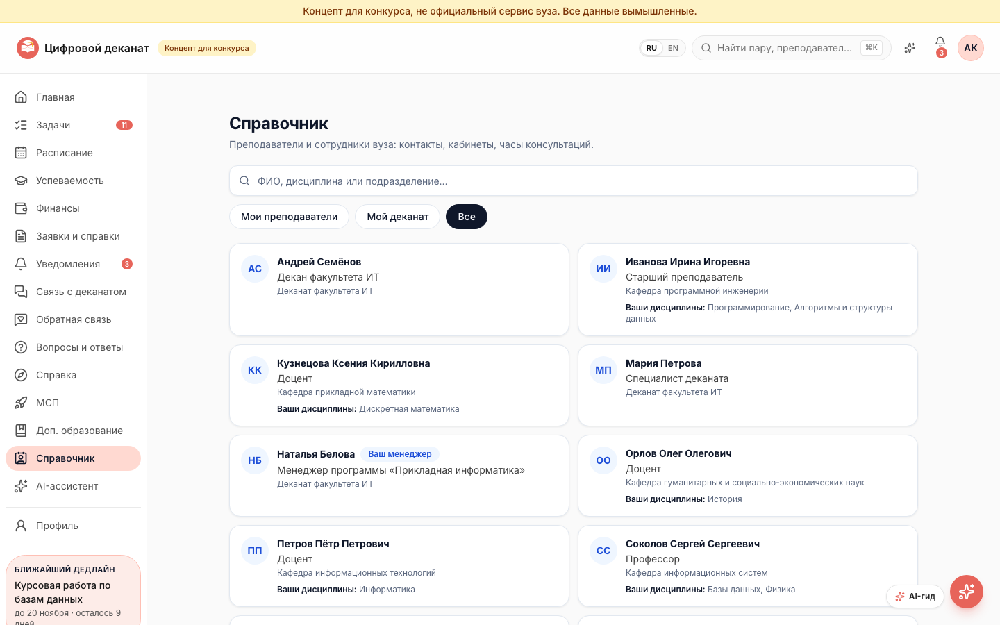
*Справочник: «Мои преподаватели» и карточки с контактами*

## 12. Мероприятия (/events)

**Назначение.** Афиша факультета и вуза: лекции, хакатоны, карьерные дни; запись в один клик.

**Как записаться (пошагово):**

1. Откройте **«Мероприятия»** — афиша от ближайших.
2. Отфильтруйте: «На этой неделе» / «Карьера» / «Онлайн».
3. Нажмите **«Записаться»** — место закреплено; счётчик покажет «Осталось N мест».
4. Передумали — повторный клик отменяет запись.
5. «Мест нет» — кнопка отключена; откройте карточку события: описание, дата/место или ссылка на трансляцию.

- **«Записаться»** — место закреплено; повторный клик отменяет. «Осталось N мест»; «Мест нет» — кнопка отключена.
- Карточка события: описание, дата/место или ссылка на трансляцию.

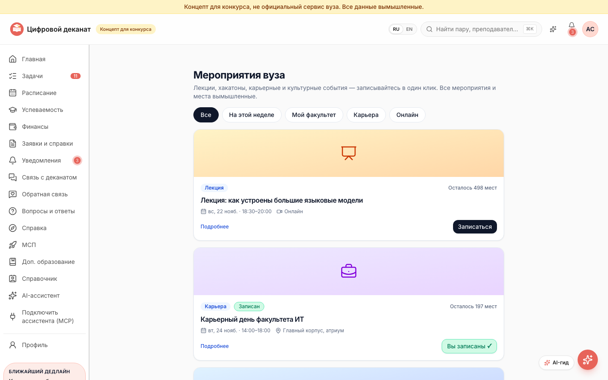
*Афиша: фильтры «На этой неделе / Карьера / Онлайн» и счётчики мест*

## 13. МСП — студенческие стартапы (/msp)

**Назначение.** Каталог студенческих проектов в духе Product Hunt: голосование, «Запуск дня», публикация собственного проекта.

**Как поддержать проект (пошагово):**

1. Откройте **«МСП»** — лента карточек с голосами; сортировки «Новые» / «Топ недели».
2. Нажмите **«▲ Поддержать»** — один голос на проект; повторный клик снимает (голосуют только студенты).
3. Смотрите **«Запуск дня»** — проект с наибольшим числом голосов.
4. Откройте карточку запуска: описание, команда, комментарии (можно ответить).

**Как запустить свой проект (пошагово):**

1. Нажмите **«Запустить проект»**.
2. Заполните: название, слоган, описание, теги.
3. Опубликуйте — проект появится в ленте (слаг генерируется автоматически).

Все проекты вымышленные — реальной коммерции нет.

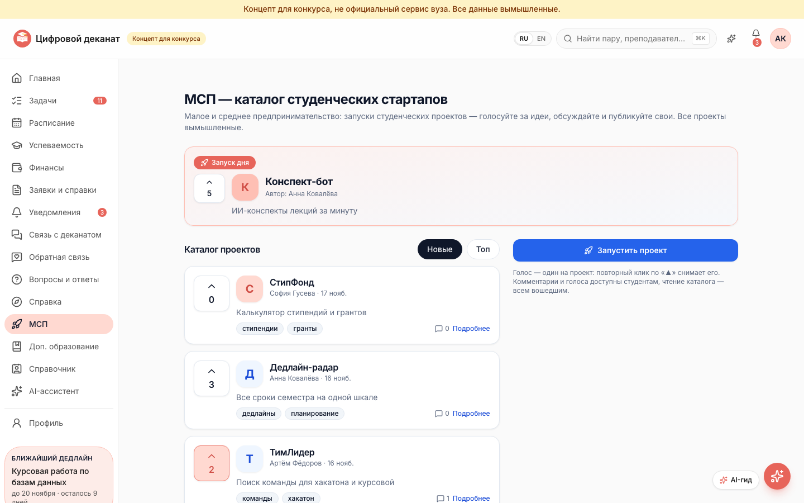
*МСП: лента проектов, голоса и «Запуск дня»*

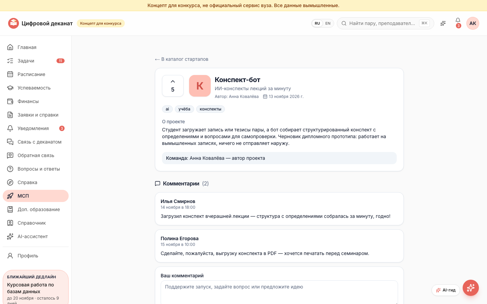
*Карточка запуска: описание, команда и комментарии*

## 14. Доп. образование (/dpo)

**Назначение.** Каталог программ дополнительного образования: записаться, следить за прогрессом, хранить документы.

**Как записаться на программу (пошагово):**

1. Откройте **«ДПО»**, вкладка **«Каталог»**.
2. Отфильтруйте по формату (онлайн/офлайн/гибрид), цене и длительности — фильтры комбинируются.
3. Нажмите **«Записаться»** — программа появится во вкладке **«Мои программы»**.
4. Следите за **полосой прогресса** и статусом (Активна / Завершена).
5. Вкладка **«Документы»**: договоры, акты, квитанции, сертификаты; «Скачать» активно после выпуска (в прототипе — заглушка).

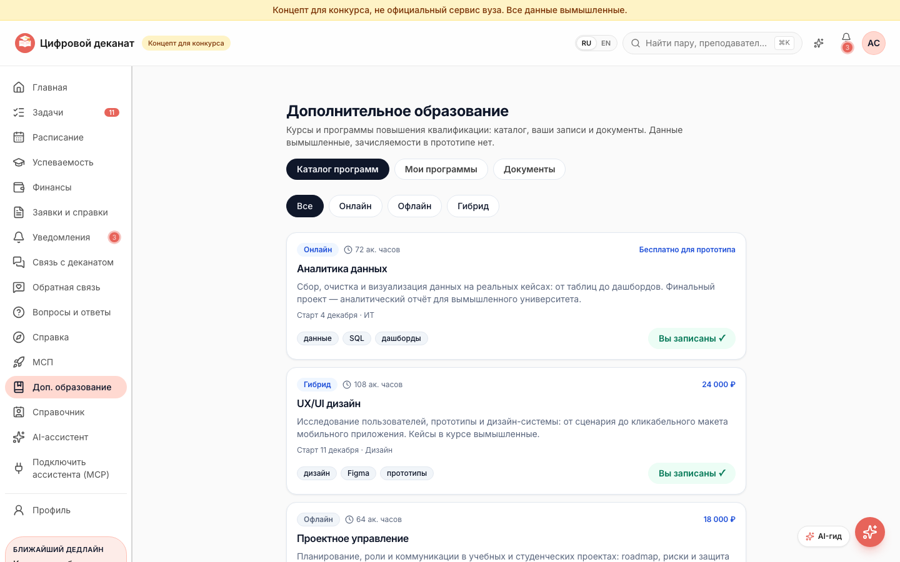
*ДПО: каталог с фильтрами, «Мои программы» и документы*

## 15. Финансы (/finance)

**Назначение.** Финансовая сводка студента: форма обучения, стипендия, задолженности, договоры и платежи.

**Как пользоваться (пошагово):**

1. Откройте **«Финансы»** — сверху сводка: форма обучения (бюджет/договор), стипендия (вид, сумма, дата ближайшей выплаты), задолженности или «нет».
2. Проверьте список договоров и платежей.
3. Откройте документы — квитанции и справки.

Реальной оплаты в прототипе нет — только демонстрационные данные.

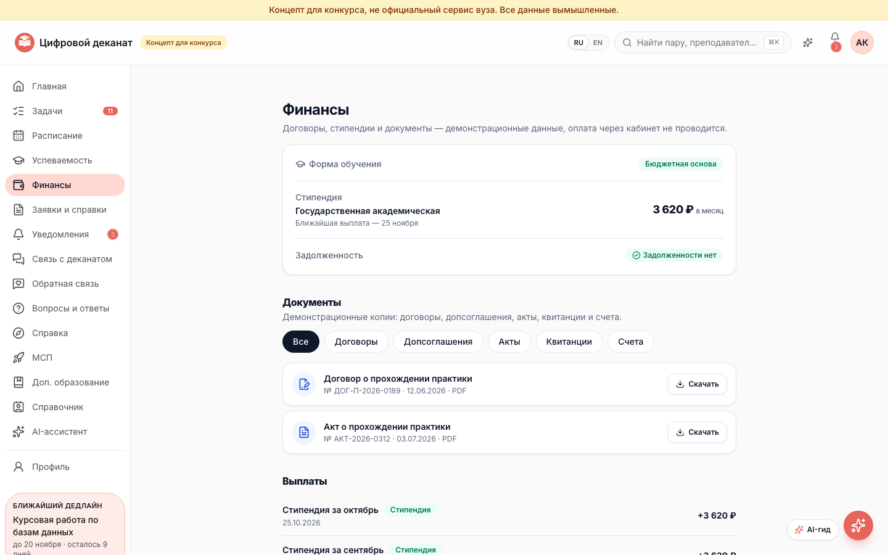
*Финансы: форма обучения, стипендия, договоры и платежи*

## 16. Вопросы и ответы (/help) и Справка (/guide)

**Назначение.** Самопомощь: короткие ответы на частые вопросы и подробный гайд по каждому разделу кабинета.

**Как найти ответ (пошагово):**

1. Откройте **«Помощь»** (/help) — FAQ по категориям.
2. Введите запрос в поиск по вопросам.
3. Ответа нет? Нажмите **«Не нашёл ответ»** — вопрос переносится в обращение в деканат или в AI-ассистента.
4. Для подробной инструкции откройте **«Справка»** (/guide): оглавление, поиск, пошаговые руководства по каждому разделу (расширенная версия — этот документ).

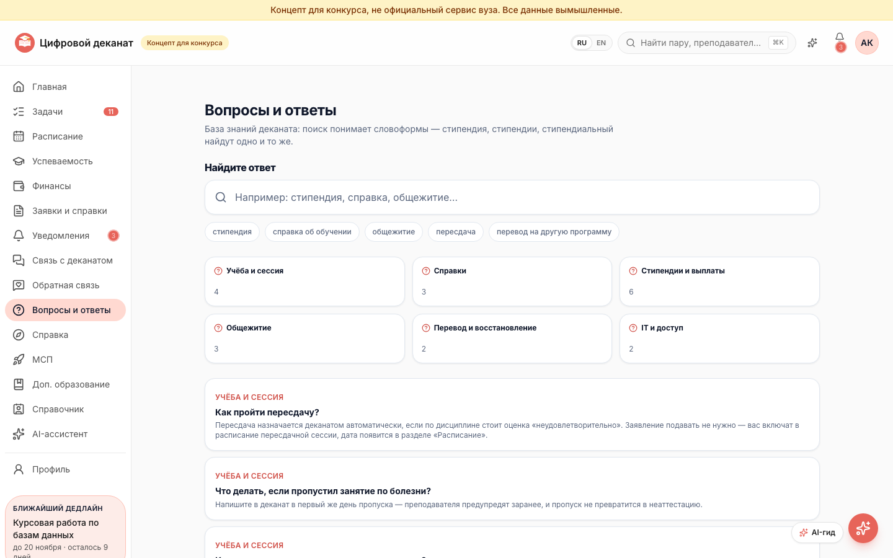
*FAQ: категории и поиск; «Не нашёл ответ» — перенос в обращение*

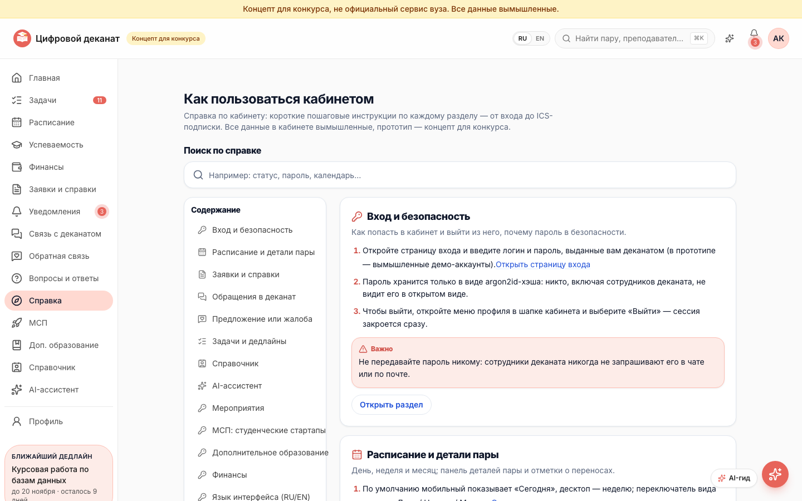
*Справка: оглавление и пошаговые инструкции по разделам*

## 17. AI-ассистент (/ai-assistant)

**Назначение.** Помощник по кабинету: отвечает на вопросы о вашей учёбе на основе встроенной справки, умеет голосовой ввод.

**Как спросить (пошагово):**

1. Откройте **/ai-assistant** или нажмите плавающую кнопку (правый нижний угол) — откроется попап-чат, не покидая текущего экрана.
2. Выберите готовую карточку («Что сдано», «Что с долгами», «Как заказать справку»…) или задайте свой вопрос (до 1000 символов).
3. Ответ строится по встроенной справке кабинета (RAG): ассистент отвечает только по официальной справке; если данных нет — честно предлагает открыть /guide или создать обращение.
4. Если внешний AI недоступен — ассистент работает в демо-режиме и показывает релевантный фрагмент справки.
5. Для диктовки используйте **микрофон** в поиске и формах; озвучка расписания включается флагом в настройках.

Ограничение: не более 10 вопросов в минуту.

- **Экран /ai-assistant**: карточки действий, чат с историей.
- **Плавающая кнопка** (правый нижний угол): попап-чат.
- **Голосовой ввод**: микрофон в поиске и формах (диктовка); озвучка расписания — в настройках включается флагом.
- **AI-динамика оценок** — отдельная карточка на /grades (см. раздел 5).

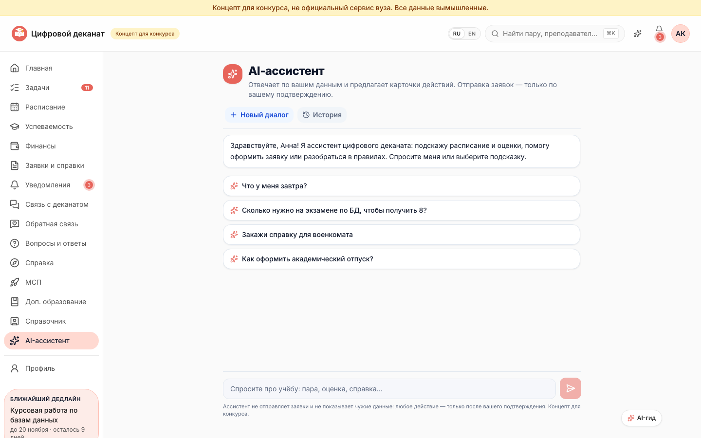
*AI-ассистент: карточки действий и чат с историей*

## 18. Уведомления (/notifications)

**Назначение.** Центр событий кабинета: расписание, оценки, заявки, новости — с управлением каналами и тихими часами.

**Как пользоваться (пошагово):**

1. Следите за **колокольчиком** в шапке — счётчик непрочитанных; клик открывает панель последних 5 уведомлений с переходами в разделы.
2. Для полной ленты откройте **/notifications**: отметка «прочитано», фильтры по типам (расписание, оценки, заявки, новости, системы, задачи, обращения).
3. **Настройте каналы**: Настройки → Уведомления — матрица «категория × канал» (push/e-mail/Telegram).
4. Задайте **окно тишины** (например 22:00–08:00) — ночью уведомления не беспокоят.

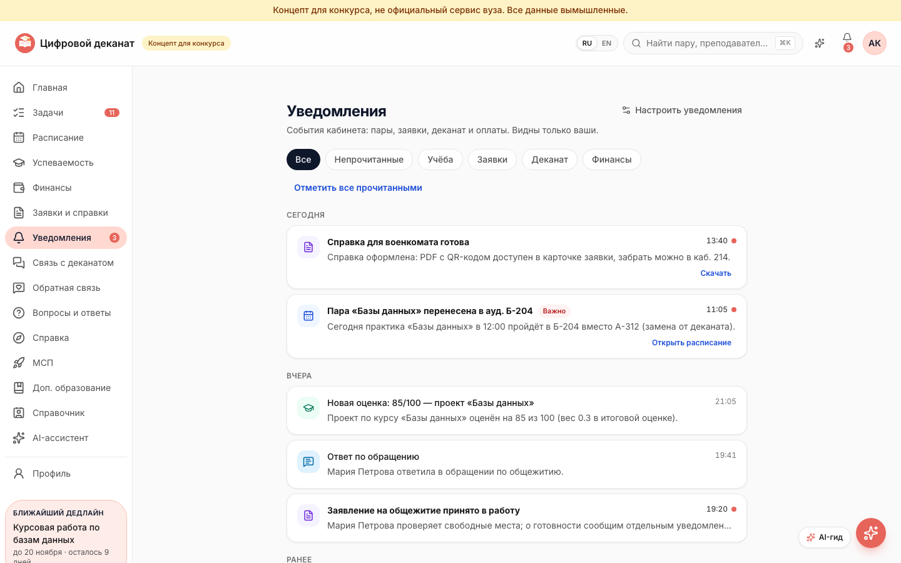
*Уведомления: полная лента, фильтры по типам, «прочитано»*

## 19. Поиск (⌘K / Ctrl+K)

**Назначение.** Глобальный поиск по кабинету — найти раздел, заявку по номеру, событие или статью справки за секунды.

**Как пользоваться (пошагово):**

1. Нажмите **⌘K / Ctrl+K** или кнопку-лупу в шапке.
2. Начните печатать: разделы, заявки по номеру (ЗД-…/SR-…), события, справка.
3. Выберите результат стрелками и Enter — переход; работает и на мобильном.

## 20. Профиль (/profile)

**Назначение.** Ваши учебные данные, которые ведёт деканат (ФИО, группа, зачётка — read-only), и контакты, которые вы редактируете сами.

**Как пользоваться (пошагово):**

1. Откройте **«Профиль»** через меню аватара в шапке.
2. Проверьте данные: программа, курс, форма обучения, период обучения — их меняет только деканат.
3. Номер зачётной книжки показывается **маскированным** — защита данных на экране.
4. Отредактируйте **контакты** (e-mail, телефон) и сохраните — изменения применяются сразу.
5. Нашли ошибку в данных? Нажмите **«Сообщить об ошибке в данных»** — создастся обращение в деканат с контекстом профиля.

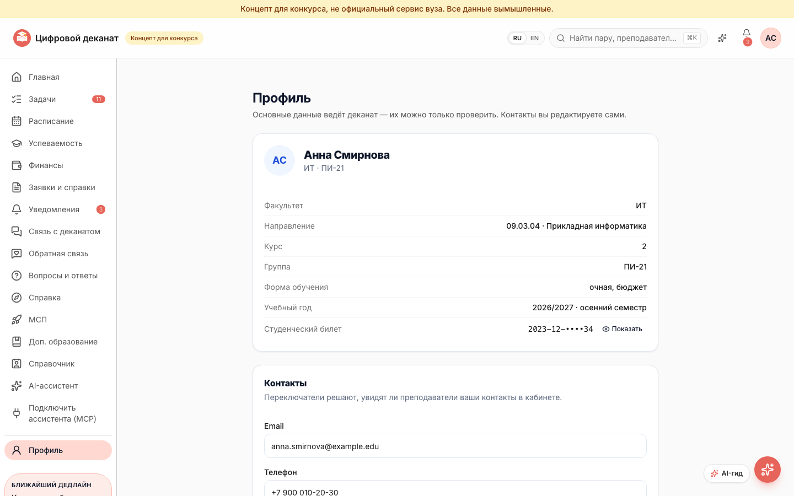
*Профиль: read-only учебные данные, маска зачётки, редактирование контактов*

## 21. Настройки (/settings)

**Назначение.** Персонализация кабинета: виджеты главной, каналы уведомлений, безопасность, MCP-токен для внешних AI-ассистентов, тема и язык.

**Как пользоваться (пошагово):**

1. Откройте **«Настройки»** через меню аватара.
2. **Главная**: перетащите виджеты в нужном порядке, лишние выключите.
3. **Уведомления**: для каждой категории выберите каналы (push/e-mail/Telegram) и задайте тихие часы.
4. **Безопасность**: смените пароль (с текущим), просмотрите активные сессии — любую отзовите.
5. **MCP-токен**: выпустите персональный токен для подключения кабинета к внешним AI-ассистентам (Claude, ChatGPT) — оценки, расписание, заявки (подробно: docs/mcp.md).
6. **Тема**: светлая/тёмная/системная. **Язык**: RU/EN (дублирует переключатель в шапке).

| Вкладка | Что настраивается |
|---|---|
| Главная | Порядок и включённость виджетов главной (drag-список) |
| Уведомления | Матрица «категория × канал» (push/e-mail/Telegram), тихие часы |
| Безопасность | Смена пароля (с текущим паролем), активные сессии с отзывом |
| MCP-токен | Персональный токен для подключения кабинета к внешним AI-ассистентам (Claude, ChatGPT): оценки, расписание, заявки |
| Тема | Светлая/тёмная/системная |
| Язык | RU/EN (дублирует переключатель в шапке) |

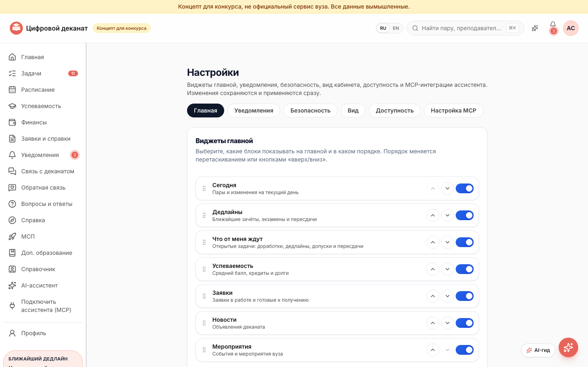
*Настройки: вкладки виджетов, уведомлений, безопасности, темы*

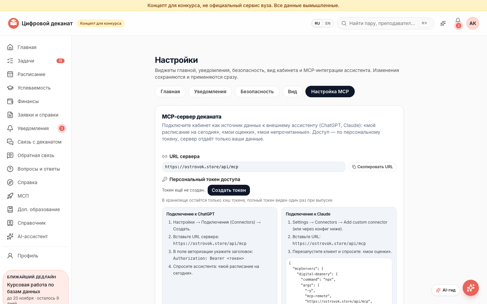
*Вкладка «Настройка MCP»: выпуск токена и готовые JSON-конфиги для клиентов*

## 22. Сотруднику деканата (/staff)

**Назначение.** Рабочее место сотрудника деканата: очередь заявок с SLA, обращения студентов, объявления и сводка факультета.

**Как обработать заявку (пошагово):**

1. Войдите на том же экране /login под `dean.kovaleva` — откроется **кабинет деканата** (студенту недоступен: любой /staff* путь вернёт HTTP 403).
2. Откройте **«Очередь заявок»** (/staff/requests): заявки студентов вашего факультета по статусам, просроченные подсвечены по SLA (3 дня на ответ).
3. Отфильтруйте по типу и сроку, нажмите **«Взять в работу»**.
4. В карточке заявки: данные студента и параметры, история событий.
5. Ведите заявку по кнопкам разрешённых переходов: Принять → В работу → Готова → Выдана; ветки «Нужна правка» / «Нужна доработка» / «Отклонить» / «Отменить» — с обязательной причиной ≥ 5 символов.
6. Для выполненной справки нажмите **«Сформировать PDF»** — документ с QR-проверкой.
7. Смена статуса мгновенно видна студенту; уведомление отправляется автоматически.

- **Обращения** (/staff/appeals): входящие по факультету, чат с шаблонами ответов, «Решено».
- **Объявления**: публикация анонса факультету или группе, предпросмотр.
- **Сводка**: заявок сегодня, среднее время ответа, просрочено.

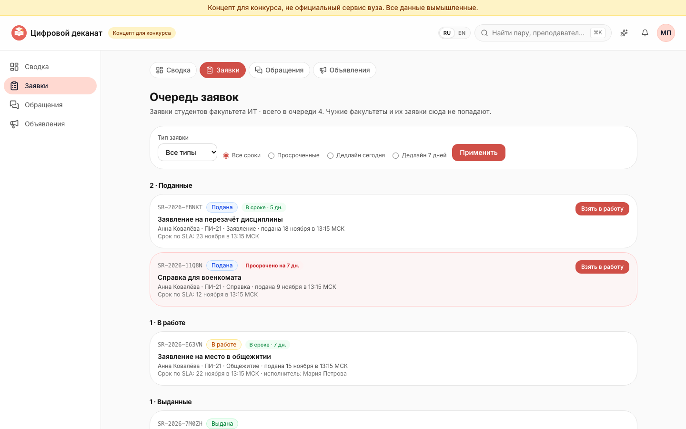
*Очередь заявок: статусы, SLA-подсветка просроченных, «Взять в работу»*

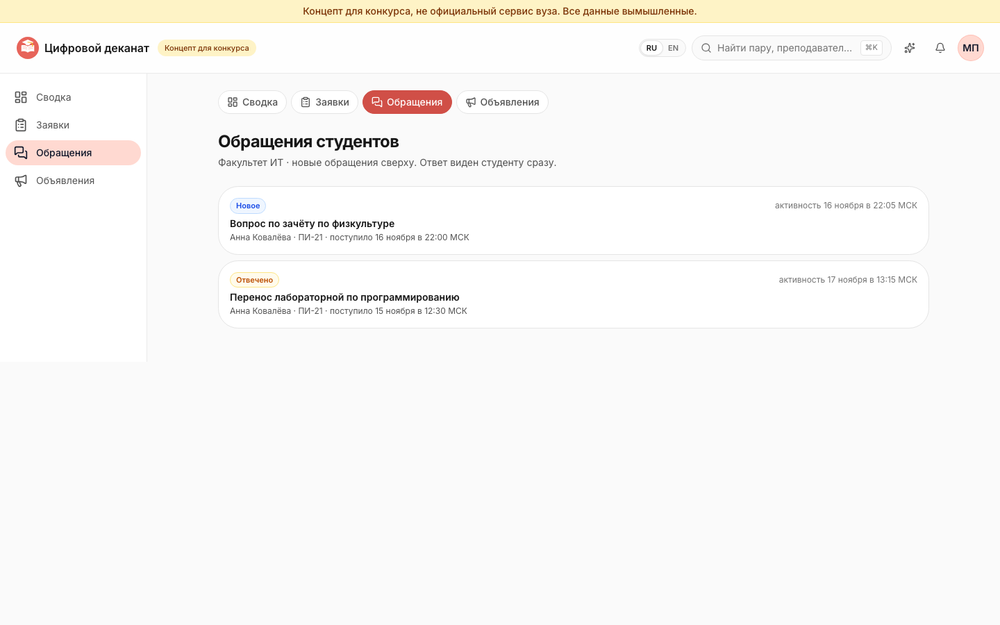
*Обращения: чат с шаблонами ответов и «Решено»*

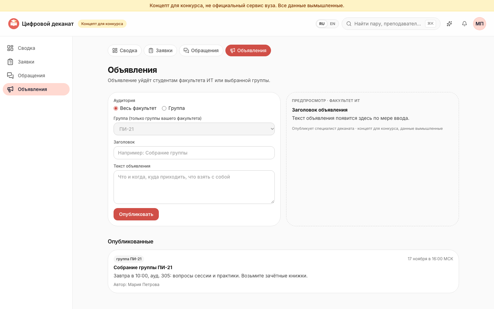
*Объявления: публикация анонса факультету/группе с предпросмотром*

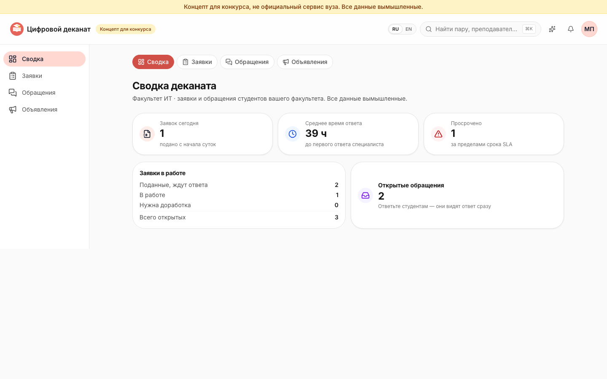
*Сводка: заявок сегодня, среднее время ответа, просрочено*

## 23. Мобильная версия

**Назначение.** Полноценный кабинет на телефоне от 360 px — все функции доступны одним пальцем.

- Нижний таб-бар: **Главная, Расписание, Оценки, Заявки, Ещё**; «Ещё» открывает полный список разделов.
- Боковая панель деталей пары становится **шторкой** снизу; формы и чаты — полноэкранные.
- Все экраны проверены на **360×800** и **1440×900**.

## 24. Ограничения прототипа

- Все данные вымышленные; зачисляемости, реальной оплаты и интеграций с вузом нет.
- Голосовой ввод/озвучка зависят от поддержки браузером (Chrome — да, Firefox — частично).
- AI-ассистент ограничен справкой кабинета и не отвечает на общие вопросы.
